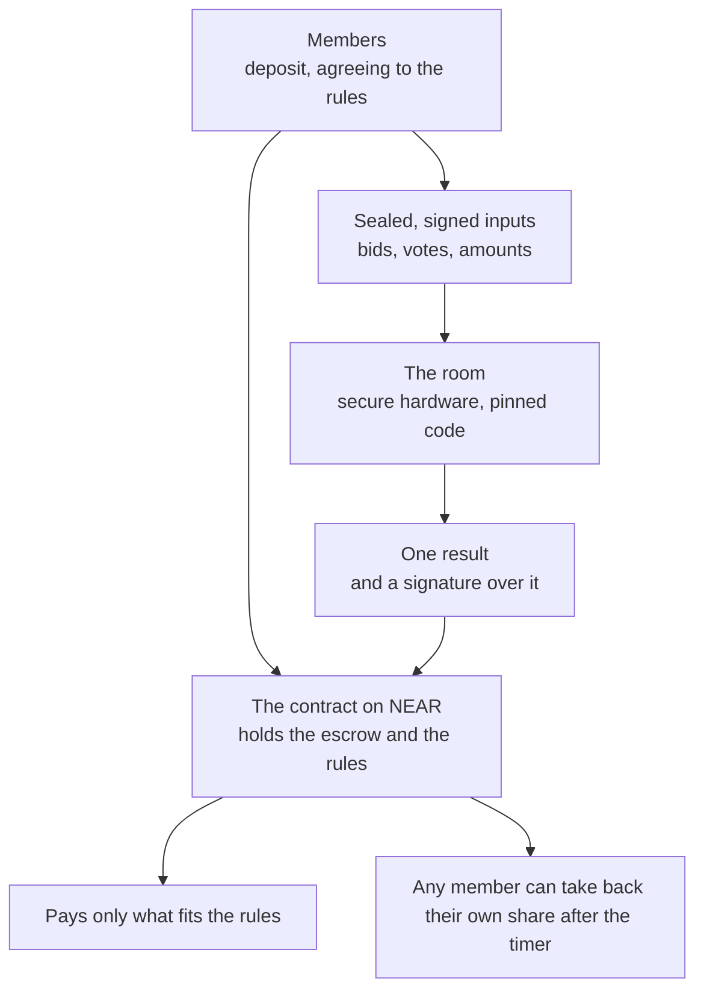
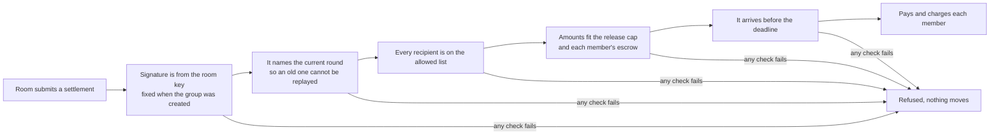
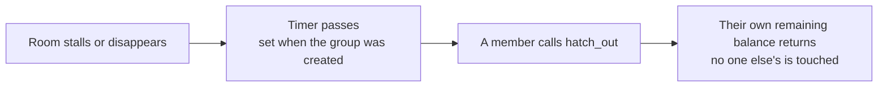

# Midge

Private rooms with public rules, on NEAR.

A group decides in private and pays out under rules that everyone can read. Members deposit into a smart contract whose rules fix who can be paid, how much can leave in a period, and by what date. Members send their bids, votes or amounts sealed to a room that runs in secure hardware. The room works out the result and signs it, and the contract pays only what fits the rules.

> Decide in private. Settle in public. Leave on your own if the room disappears.

**Chain:** NEAR testnet
**Site:** https://midge.vercel.app (not yet updated for the latest hardware runs)
**Demo video:** link added at submission
**Playground:** in progress. Until it exists, the commands below check everything.

### [Start here](docs/START_HERE.md)

The start-here guide gives the commands that check this project, what each one proves, and what it skips.

Deposits, balances and payments are public on NEAR, and so are the rules and the list of accounts that may be paid. What stays private is what members bid, vote or decide. Everything that runs on a chain runs on a testnet. The words used here are defined in [`docs/GLOSSARY.md`](docs/GLOSSARY.md).

**The fastest way to judge this project needs no keys and no wallet.** Run `npm ci`, then `npm run verify:fast` (about 30 seconds) and `npm run verify:onchain`. The second one reads the live contract from the chain and compares its code hash with the one recorded in this repository. A page that does the same in your browser is being built.

---

## The problem

A group that pools money on a public chain has two bad choices. If the plan is public, everyone can see it and trade against it. If one operator holds the money, the operator can lose it or take it, and the group depends on that operator to get it back.

Midge splits the job. The contract holds the money and enforces the rules. A room in secure hardware opens the sealed inputs and works out the result, and it can only propose a payment the rules allow. Any member can take their own share back after a timer, with no help from the room or its operator.

## How it works



The room never holds money, and it holds no withdrawal key. Before the contract pays, it checks five things about the room's settlement, shown below. A settlement that fails any check is refused and nothing moves.



The exit does not depend on the room. If the room stalls or its operator disappears past the timer, a member calls `hatch_out` and gets back their own remaining balance. It touches no other member's escrow.



The hardware proves which code the room runs, through a Phala TDX attestation checked against the Intel certificate chain and a pinned image. It does not prove the code is bug free, and the room can read the inputs it is given. The trust model is in [`docs/WHITEPAPER.md`](docs/WHITEPAPER.md).

## What the room can do

| Program | What the room does | Where it has run |
|---|---|---|
| Pay run | Checks payee-signed invoices against the employer's lines, pays one-time addresses and the tax and benefits accounts, gives each payee a signed private receipt, and opens chosen lines for an auditor | Real hardware |
| Sealed quotes (RFQ) | Buy and sell side. The lowest eligible ask or the highest eligible bid wins, and the taker's side stays sealed | Real hardware |
| Ballot | Counts signed ballots by head or by weight, with a majority, plurality or supermajority rule, and publishes only the winner | Real hardware |
| Pool | Totals sealed amounts into one payment and charges each member their own. Over a cap it takes amounts first-come or scales all of them pro rata | Real hardware |
| Auction | First-price, second-price and uniform-price, with a reserve | Testnet, on a local host |
| Block trade | A pro-rata cross | Testnet, on a local host |

A settlement pays at most 8 recipients (GAP-053).

## The contracts on testnet

| Account | What it is | Code hash |
|---|---|---|
| [`c.fly-1793636729.testnet`](https://testnet.nearblocks.io/address/c.fly-1793636729.testnet) | The contract every claim here is about. It holds the escrow, the rules, the signed one-use settlements and the exit. | `BVcq86Wz5Q3kcdBdcUhfQVfQtC6CmGwcXuMd52aW6gTp`, live since 2026-11-11 06:38 UTC |
| `m.fly-1793636729.testnet` | A copy the lab uses for experiments that need a build with a test-only setting. It is not the contract being judged. | Its own build |

The contract has run 12 code hashes in all, and [`docs/canonical/deployments.json`](docs/canonical/deployments.json) lists each one with the reason for the change. The source is in `contracts/fly-coordinator`, and the build reproduces the deployed bytes (CLM-BUILD-MATCHES-DEPLOYED-01).

**What has actually run**, each with a recorded run you can check offline:

| Stage | Evidence |
|---|---|
| The room on real Phala TDX hardware, settling on the contract | `docs/lab-runs/20261112T173152Z-e25d` |
| Pay run with signed invoices, private receipts and an auditor pack | `docs/lab-runs/20261112T031407Z-8c64` |
| Sealed quotes, buy side and sell side | `docs/lab-runs/20261112T032202Z-a3a8`, `docs/lab-runs/20261112T032438Z-98db` |
| Signed ballot, then a weighted supermajority ballot | `docs/lab-runs/20261112T032730Z-3b68`, `docs/lab-runs/20261112T173152Z-e25d` |
| Pools, first-come and pro-rata | `docs/lab-runs/20261112T031652Z-b62e`, `docs/lab-runs/20261112T173152Z-e25d` |
| A contract asks an OutLayer program to sign a settlement, and the group settles | CLM-OUTLAYER-CONTRACT-01 |
| A contract asks NEAR's signer for a payment on Solana devnet and Ethereum Sepolia | CLM-CONTRACT-FOREIGN-01 (Chain Signatures, LIVE on testnet) |
| An optional AI review of a pay run, checked by code, against the attested NEAR AI Cloud model | `docs/lab-runs/20261112T173632Z-569c` |

A replay of an earlier settlement was recorded and refused because the group was already settled, not for a nonce mismatch.

## One full loop

The run `docs/lab-runs/20261112T031407Z-8c64` is a complete pay run on real hardware, and the detailed report is next to it in `report.md`. First, a Phala TDX machine started the room, and the checker verified its hardware attestation and the pinned code before any member trusted it. Second, an employer and three payees sent sealed, signed lines and invoices, and the room refused the run because one invoice said 0.03 and the approved line said 0.035. Third, after the line was corrected the room signed a settlement, and the contract accepted it in transaction [`J7xyrFuf…`](https://testnet.nearblocks.io/txns/J7xyrFufPi9Lv2FWQn56cxWwqzfHyzC53gJYU7wNkQGV). Fourth, the chain showed exact amounts, 0.043 to one payee, 0.012 to the tax account and 0.006 to the benefits account, and the employer was charged the gross total. Fifth, each payee opened their own signed receipt and checked it against the order hash on the chain, and another payee's key could not open it. Sixth, the employer opened one line for an auditor, who verified it against the chain and saw no other person. Seventh, the accounts, the group and the machine were deleted, at a cost of about $0.002. Amounts and recipients stay public on NEAR, so what the loop hides is who each address belongs to.

## Verify it yourself

You need Node.js 18 or newer. The full check also needs Rust.

```bash
npm ci
npm run verify:fast                       # about 30 seconds, Node.js only: the JavaScript tests and the claims ledgers
./scripts/verify                          # the whole check, about 6 minutes on a fresh clone, no keys
npm run verify:onchain                    # reads the live contract and compares its code hash with the one recorded in deployments.json
node lab/verify-run.js docs/lab-runs/20261112T173152Z-e25d   # re-checks one recorded hardware run offline
```

The full check exited 0 on a fresh clone of `master` on 2026-11-12. Two checks skip without keys, which are the live NEAR AI inference check and anything that rents hardware. The hardware runs cannot be repeated without a Phala account, so their logs are in `docs/lab-runs/`, hash-chained so a change to any event shows.

- The contract has 174 Rust tests (unit, integration, invariant and state machine). The JavaScript side has 473 tests, which include checks that this README and the other public documents agree with the code.
- The lab has 66 experiments with a recorded run, and 65 have at least one passing run. The one exception failed on hardware, is kept as a failure and is explained in GAP-046.
- Each experiment states its predictions before it runs. Failed runs are kept. The AI review of a pay run, for example, failed twice before it passed, and all three runs are in `docs/lab-runs/`.
- Every claim has an entry in [`foundry/claims.jsonl`](foundry/claims.jsonl) with the command that reproduces it, and every known problem, open or closed, is in [`foundry/gaps.jsonl`](foundry/gaps.jsonl).

## Install and run

```bash
git clone https://github.com/etvjay/midge.git
cd midge
npm ci
make test        # the architecture suite, about 7 seconds
make rust        # the contract tests
make wasm        # builds the contract
node lab/run.js  # the offline lab experiments
```

[`docs/DEPLOYMENTS.md`](docs/DEPLOYMENTS.md) covers the site, and the lab's hardware and testnet tiers need keys described in [`docs/LAB.md`](docs/LAB.md).

## Documentation

| Topic | Document |
|---|---|
| The words, in plain language | [`docs/GLOSSARY.md`](docs/GLOSSARY.md) |
| A short guide for agents and judges | [`docs/START_HERE.md`](docs/START_HERE.md) |
| What exists today, real or simulated | [`docs/canonical/CURRENT_STATE.md`](docs/canonical/CURRENT_STATE.md) |
| The design and the trust model | [`docs/WHITEPAPER.md`](docs/WHITEPAPER.md) |
| Contract states and invariants | [`docs/STATE_MACHINE.md`](docs/STATE_MACHINE.md) |
| The demo script | [`docs/canonical/DEMO_SCRIPT.md`](docs/canonical/DEMO_SCRIPT.md) |
| The submission text | [`docs/hackathon-submission.md`](docs/hackathon-submission.md) |
| What is planned and not built | [`docs/ROADMAP.md`](docs/ROADMAP.md) |
| The full earlier README, with the problem figures, the measured baseline and the file index | [`docs/README_FULL.md`](docs/README_FULL.md) |

**Evidence and method**

| Topic | Document |
|---|---|
| The evidence behind each claim | [`docs/canonical/EVIDENCE_LEDGER.md`](docs/canonical/EVIDENCE_LEDGER.md) |
| How the lab runs and records experiments | [`docs/LAB.md`](docs/LAB.md) |
| Every code hash the contract has run, with reasons | [`docs/canonical/deployments.json`](docs/canonical/deployments.json) |
| Decisions and why | [`docs/canonical/DECISIONS.md`](docs/canonical/DECISIONS.md) |
| Self-assessment against the judging dimensions | [`docs/canonical/RESCORE_2026-11-07.md`](docs/canonical/RESCORE_2026-11-07.md) |

**Security and attacks**

| Topic | Document |
|---|---|
| Threat model | [`docs/security/threat-model.md`](docs/security/threat-model.md) |
| Security review | [`docs/security/review-2026-11-02.md`](docs/security/review-2026-11-02.md) |

Each defensive claim has a paired experiment that tries to break it, and failures are kept.

| Experiment | What it attacks |
|---|---|
| [`50-security-agent.js`](lab/experiments/50-security-agent.js) | A hijacked agent's limited key, which must not move funds past the rules |
| [`87-two-room-live.js`](lab/experiments/87-two-room-live.js) | Two rooms that must agree: a lying second room, one room twice, one signature alone, a member who equivocates, a vanished room |
| [`106-hosted-failclosed-live.js`](lab/experiments/106-hosted-failclosed-live.js) | Both escrow providers unreachable, on hardware: the room must refuse and not guess |
| [`118-hosted-acctcheck-fail-live.js`](lab/experiments/118-hosted-acctcheck-fail-live.js) | One account-check provider down, on hardware |
| [`119-foreign-signer-fail-live.js`](lab/experiments/119-foreign-signer-fail-live.js) | NEAR's signer failing in the middle of a request |
| [`invariants.rs`](contracts/fly-coordinator/tests/invariants.rs) and [`state_machine_tests.rs`](contracts/fly-coordinator/tests/state_machine_tests.rs) | The contract's invariants and state machine, with generated inputs |

## What is not shown

- Reach and trust.
  - Nothing runs on mainnet.
  - One operator ran every room and account in the tests, so independent operators have not been shown.
  - The deployer key of the testnet contract is still held, so its holder could change the contract (GAP-044).
- Privacy.
  - Deposits, balances and payments are public, so a pay run hides who is paid and shows how much.
  - Anyone can read who may be paid, the limits and the deadline. Hiding them is planned and not built ([`docs/ROADMAP.md`](docs/ROADMAP.md)).
  - The room can read the inputs it is given. The hardware proves which code runs, and it does not make the room blind.
- Scale. A settlement pays at most 8 recipients (GAP-053).
- Simulations stay labelled as simulations, and they are the FAR shard, Dark Vault pods, the compute syndicate and the agent swarm demos.

## Originality

The first commit in this repository is dated 2026-11-02, the second day of the hackathon, and the code in `contracts/`, `src/`, `lab/`, `tests/` and `scripts/` was written during it. The libraries it builds on were not: the NEAR SDK, the `@noble` cryptography packages, Phala's dstack and cloud, NEAR AI Cloud, OutLayer, NEAR's Chain Signatures and Intel's DCAP quote verifier. They are used as published.

Claude Code wrote much of the code and the documents, under the author's direction, and most commits carry a `Co-Authored-By` line that names it. The author set the design and approved every hardware run and every push.

## Licence

MIT. See [`LICENSE`](LICENSE).

## A note on names and history

Midge was previously called Fly. Internal identifiers keep the old codename on purpose (the `fly-coordinator` crate, the `FLY_*` environment variables and the deployed testnet account `c.fly-1793636729.testnet`), so the on-chain evidence and the reproducible build still match. In the code a group is a syndicate, the room is the Roost, the rules and the contract are the Nest, and the exit is `hatch_out`. "HAQ" appears in older code and in the contract's error messages, such as `[HAQ REJECT]`, and labels the settlement checks.

On 2026-11-12 the history of `master` was rewritten once to remove a directory committed by mistake. The tree is identical before and after, and [`docs/canonical/COMMIT-MAP-2026-11-12.md`](docs/canonical/COMMIT-MAP-2026-11-12.md) maps the old commit ids to the new ones.
