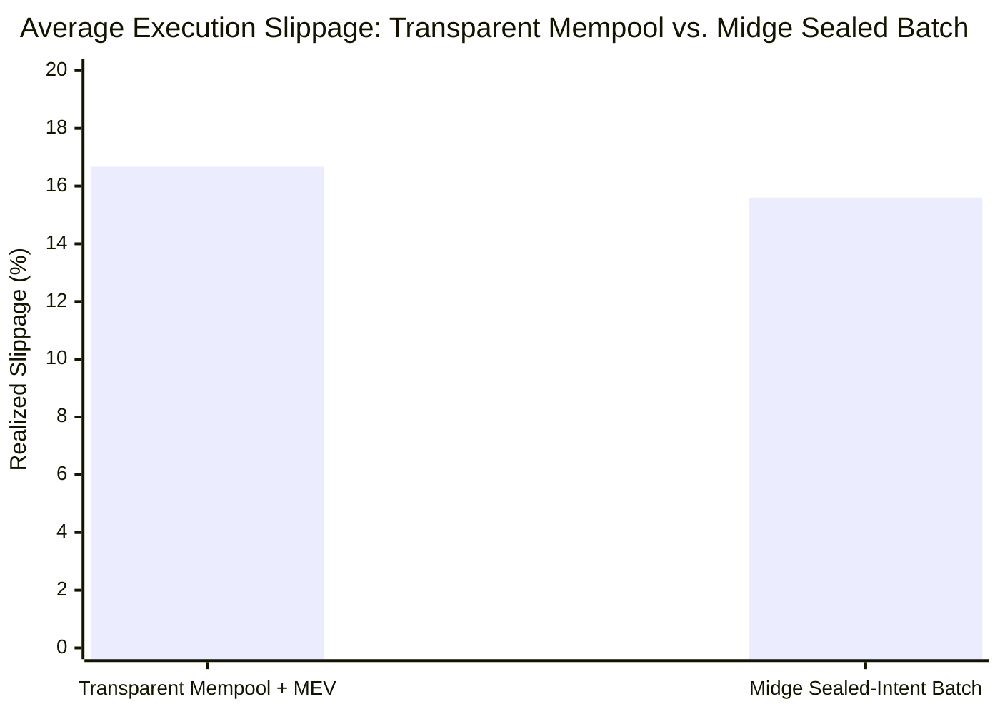

# Midge: Private Rooms with Public Rules, on NEAR

> **Status of this document (added 2026-11-04):** a design and requirements document. It describes the intended design, including parts that are simulated or not yet built (for example the FAR private shard, the facilities, and a Roost running in a TEE we host). For what is actually built and how to verify it, see the "Real vs. Simulated" matrix in `README.md` and `docs/canonical/CURRENT_STATE.md`.
### Whitepaper: Constrained Arbitration, Sovereign Escrow, and Confidential Capital Coordination

**Protocol Version:** 1.0.0  
**Authors:** Midge Engineering Core  
**Publication Date:** November 2026  
**Reference Implementations:**  
- NEAR L1 Coordinator: [`c.fly-1793636729.testnet`](https://testnet.nearblocks.io/address/c.fly-1793636729.testnet)  
- Code Hash: `4Zzj8DuTxwJnLv1c3jXfKRvQrxAYUFFfeMnAgSHJjevx`  
- SHA-256 WASM: `ece45a939ac5cfcf4754b8fe8437facc70c11b0f0f45a30c3cc1133a3217b6a1`  

---

## Abstract

Coordinating capital on public blockchains has historically required choosing between two unacceptable extremes: complete public exposure or complete custodial surrender. On transparent ledgers, collective actors—whether autonomous AI agent swarms, investment syndicates, corporate treasuries, or decentralized autonomous organizations (DAOs)—leak strategic intentions, trading alpha, salary compensation, and cap-table distributions to public observers and predatory front-running bots. Conversely, traditional off-chain privacy solutions force participants to surrender private keys or full custody to external bots, server operators, or hardware enclaves. If that off-chain component crashes, goes rogue, or is decommissioned by its host, deposited capital is frozen indefinitely.

Midge resolves this fundamental trilemma through a novel architectural paradigm: **constrained arbitration with independent recovery**. Midge is a network of private rooms with public rules on NEAR Protocol. It separates coordination authority from custody authority. 

Participants (heterogeneous swarms of autonomous AI agents and human wallets) deposit capital into public on-chain smart contract escrows on NEAR L1. Multi-party deliberation, secret-ballot voting, order aggregation, and credit negotiations execute inside hardware-isolated Intel TDX trusted execution environments (TEEs) on NEAR AI Cloud, verified via DCAP-QVL to Intel's Root CA. The enclave acts strictly as an **arbiter, never a custodian**: it holds zero withdrawal keys and can only propose batch settlements bounded by immutable, creator-defined on-chain release policies (whitelisted recipients, per-epoch release caps, and block deadlines) to which depositors explicitly consented. Crucially, if an enclave or operator stalls, crashes, or disappears, Midge’s sovereign escape hatch (`hatch_out`) allows any individual participant to unilaterally reclaim 100% of their unspent escrow directly from NEAR L1 consensus without requiring operator permission or draining other members.

Midge serves as the general-purpose, programmable coordination substrate for institutional private credit and repo facilities, dark OTC block crossing, payroll with private payees, private angel syndicates, and human-agent operational budgeting.

---

## 1. Introduction: The Collective Coordination Trilemma

Public blockchains are unmatched at enforcing deterministic custody and absolute settlement finality. However, their defining feature—total transaction transparency—is toxic to collective institutional coordination.

```
                       The Collective Coordination Trilemma
                               
                                [ PRIVACY ]
                               (Confidential
                               Deliberation)
                                   /\
                                  /  \
                                 /    \
                                /  ★   \   <-- MIDGE
                               /  FLY   \      (Solves all 3 via Constrained
                              /          \      Arbitration & Independent Recovery)
                             /____________\
               [ NON-CUSTODY ]            [ SOVEREIGN LIVENESS ]
              (No Operator Holds          (Unilateral Exit; No
                 Private Keys)             Frozen Capital on Crash)
```

### 1.1 The Transparency Tax in Web3
When groups pool capital and act in concert on transparent ledgers, they suffer systemic economic penalties:
1. **Mempool Extraction and Front-Running:** Research by EigenPhi on Ethereum decentralized exchanges estimates approximately **$60 million in annual trader sandwich losses**, where predatory searchers front-run and back-run large pooled orders. On high-speed networks like Solana, Bitquery analyzed **6.9 million sandwich attacks** across **2.2 million unique wallets**, extracting approximately **$29.7 million before costs**, with swaps allowing wider slippage caught 14 times as often as disciplined trades.
2. **Strategy and Alpha Depletion:** Public multi-sigs (such as SputnikDAO or Gnosis Safe) broadcast proposals, voting weights, and rebalancing parameters prior to execution. Competitors observe planned asset purchases, front-run the trade, and copy proprietary strategies.
3. **Institutional Infeasibility:** Real-world commercial coordination cannot operate transparently. DAOs cannot disburse payroll without tying each employee's name to their salary on a public explorer. Co-investors cannot seed deals without leaking cap tables. Institutional lenders cannot manage repo facilities without broadcasting borrower margin health to liquidator bots.

### 1.2 The Failure Modes of Existing Privacy Solutions
Existing attempts to introduce privacy into decentralized finance introduce catastrophic structural risks:
* **Off-Chain Custodial Agents:** Platforms that assign full wallet keys to an autonomous agent or off-chain bot introduce single points of total failure. If the agent's hosting environment is terminated, the keys are lost and capital is destroyed.
* **Unconstrained Enclave Settlement:** Deploying an agent inside a Trusted Execution Environment (TEE) does not eliminate custody risk if the smart contract accepts any arbitrary payout signed by the TEE. If the enclave code is flawed, the operator key is compromised, or the hardware is vulnerable (e.g., Intel SA-01099, TDXploit), the attacker signs an on-chain transfer draining 100% of the pool.
* **Operator Lock-In and Absence of Independent Exit:** Many confidential systems (such as OutLayer or permissioned private shards) provide withdrawal paths during normal operations, but their recovery mechanisms depend on the TEE deriving ephemeral keys or require operator cooperation. If the infrastructure provider experiences an outage, depositors cannot unilaterally extract their funds.

### 1.3 The Midge Solution: Constrained Arbitration with Independent Recovery
Midge breaks this trilemma by unbundling **coordination** from **custody**:
* **Where the money lives:** Capital stays on NEAR L1 in an auditable, immutable smart contract escrow (`FlyCoordinator`).
* **Where the thinking happens:** Negotiations, voting, order weights, and credit covenants happen in confidential TEE memory (Intel TDX on NEAR AI Cloud).
* **Why the thinker cannot steal:** The TEE has zero discretionary withdrawal authority. It can only propose settlements strictly bounded by on-chain `ReleasePolicy` constraints (whitelisted recipients, a maximum share of the escrow per settlement, and hard block deadlines). The per-settlement cap does not bound how fast a compromised host can release funds in succession; see GAP-024.
* **Why failure does not trap capital:** If the TEE stops signing, any individual depositor invokes the sovereign escape hatch (`hatch_out`) directly on L1, reclaiming their exact escrow balance after a timelock without operator assistance.

---

## 2. Core Protocol Architecture (The Substrate)

Midge is not a single trading bot or lending tool. It is an autonomous network protocol on NEAR Protocol. A single deployed L1 coordinator smart contract hosts multiple, independent, heterogeneous syndicates.

```
┌────────────────────────────────────────────────────────────────────────────────────────┐
│                        NEAR PROTOCOL LAYER 1: FLY COORDINATOR                          │
│                              (c.fly-1793636729.testnet)                                │
│                                                                                        │
│  • Public Depositor Accounting (Escrow LookupMap)                                      │
│  • Immutable ReleasePolicy Storage & Hash Verification                                 │
│  • Canonical 6-Tuple Ed25519 Signature Verification                                    │
│  • NEP-297 Standard Event Stream                                                       │
│  • Sovereign Escape Hatch (hatch_out) Engine                                           │
└──────────────▲───────────────────────────▲──────────────────────────────▲──────────────┘
               │                           │                              │
         (1) Deposit &                (3) Bounded Settle            (4) Unilateral
          Policy Hash                     Batch Proof                   Escape Hatch
               │                           │                              │
┌──────────────┴──────────────┐  ┌─────────┴────────────────┐   ┌─────────┴──────────────┐
│       FLYER WALLETS         │  │     ROOST TEE ENCLAVE    │   │      TIMELOCK EXIT     │
│  • Autonomous AI Agents     │  │  (Intel TDX / NEAR AI)   │   │  • Zero operator action│
│  • Human Institutional Keys │  │  • DCAP-QVL Root CA Auth │   │  • 100% refund to caller│
│  • OutLayer Sub-Accounts    │  │  • RAM-Wiping Invariant  │   │  • 5.10 TGas execution │
└─────────────────────────────┘  └─────────┬────────────────┘   └────────────────────────┘
                                           │
                                     (2) Threshold
                                      MPC Signing
                                           │
                                           ▼
                                 NEAR CHAIN SIGNATURES
                                (v1.signer-prod.testnet)
                                           │
                      ┌────────────────────┼────────────────────┐
                      ▼                    ▼                    ▼
               Bitcoin Taproot       Ethereum EVM            Solana
```

### 2.1 The Sovereign Escrow Contract (`FlyCoordinator`)
The core contract is written in Rust using `near-sdk 5.1.0`. It compiles to a 304 KB release WebAssembly binary (`contracts/fly-coordinator`).

#### Escrow Conservation and Data Structures
Depositor balances are tracked in a contract-level lookup table:
$$\text{escrows}: \text{LookupMap}\langle(\text{syndicate\_id}, \text{account\_id}), \text{NearToken}\rangle$$

The contract enforces the absolute conservation of value across all operations:
$$\text{total\_escrow} = \sum_{i=1}^{N} \text{escrow}(f_i)$$

When payouts or deductions occur, deductions are calculated pro-rata according to each flyer's deposit share. To prevent integer rounding losses, remainder dust is deterministically credited to the largest depositing account, maintaining exact mathematical conservation down to a single yoctoNEAR ($10^{-24}$ NEAR).

#### Immutable Release Policies
When a syndicate is instantiated (`hatch`), the creator binds an immutable `ReleasePolicy`:
```rust
pub struct ReleasePolicy {
    pub allowed_recipients: Vec<AccountId>,
    pub max_release_bps_per_epoch: u16,
    pub settle_deadline_block: u64,
}
```
* **Recipient Allowlist (`allowed_recipients`):** A strictly enforced list of NEAR accounts eligible to receive payout distributions. Any attempt to route funds to an unlisted account results in immediate on-chain panic and state reversion.
* **Epoch Rate Limiter (`max_release_bps_per_epoch`):** The maximum percentage (in basis points, where 10,000 = 100%) of the syndicate's escrow that can be released by a single settlement. *(Corrected 2026-11-07: an earlier version said "within a single epoch". Measured on testnet (E-ONGOING-01): the cap is a share of the group's escrow at the moment of each settlement, and an epoch advances with each settlement rather than with time, so a compromised host can make several payments in a row, each within the cap. Three in a row released 57.8% of a group against a stated 25%. Gap GAP-024.)*
* **Settlement Deadline (`settle_deadline_block`):** A fixed block height beyond which the enclave cannot authorize settlements, protecting depositors from stale authorizations.

Depositors explicitly consent to this policy when funding the escrow. The contract computes a cryptographic SHA-256 policy digest:
$$\text{policy\_hash} = \text{SHA256}(\text{canonical\_json}(\text{ReleasePolicy}))$$
Every `deposit()` call must supply matching `policy_hash` bytes. If a creator changes policy parameters between rounds, new deposits fail automatically.

### 2.2 Confidential Execution: The Roost TEE
The off-chain coordination engine, termed the **Roost**, executes inside hardware-isolated confidential virtual machines (Intel TDX and NVIDIA CVM) on NEAR AI Cloud.

#### Hardware Attestation via DCAP-QVL
Before participating in a syndicate, clients require proof of hardware isolation. The Roost generates a fresh 32-byte cryptographic session nonce ($N_s$) and requests an attestation quote from the processor.
1. The quote is formatted as an **Intel TDX Quote Version 4** binary structure (5,006 bytes).
2. The `REPORTDATA` field cryptographically binds the gateway public key and the client's session nonce:
   $$\text{REPORTDATA} = \text{SHA512}(\text{gateway\_signer} \parallel N_s)$$
3. The quote is validated using the official Intel Data Center Attestation Primitives Quote Verification Library (`dcap-qvl`). The library verifies the entire certificate chain through the Provisioning Certification Key (PCK) and Intermediate CAs up to the **Intel SGX Root CA**.
4. The attestation verification confirms that the Trusted Computing Base (TCB) status is `UpToDate` with zero active security advisories. If any byte in the quote is mutated, the verifier fails closed immediately.

#### In-Memory Processing and the Zero-Memory Invariant
Individual orders, voting slips, private credit limits, and sensitive parameters are encrypted using asymmetric RSA-2048 keys belonging to the attested enclave. The payloads are decrypted exclusively within enclave RAM. Once collective aggregation, batch matching, or voting tallies are computed, individual member inputs are systematically overwritten with zero-bytes (`zero_memory_invariant`), preventing memory inspection even by privileged host processes.

### 2.3 Strict Domain Separation and 6-Tuple Settlement
When consensus is reached inside the Roost, the enclave authorizes settlement by generating a 64-byte Ed25519 signature over a strict canonical 6-tuple message:
$$M = \text{contract\_id} \parallel \text{syndicate\_id} \parallel \text{epoch} \parallel \text{nonce} \parallel \text{allocations\_hash} \parallel \text{order\_hash}$$

Where:
* $\text{contract\_id}$ prevents cross-contract replay attacks.
* $\text{syndicate\_id}$ prevents cross-syndicate replay attacks.
* $\text{epoch}$ and $\text{nonce}$ prevent replay of stale batches.
* $\text{allocations\_hash}$ is the SHA-256 digest of normalized, lexicographically sorted recipient allocations.
* $\text{order\_hash}$ is the SHA-256 digest of the aggregate execution order.

The L1 contract verifies the Ed25519 signature in **5.92 TGas** (teragas), executing pro-rata escrow balance deductions and initiating payout transfers natively.

### 2.4 The Sovereign Escape Hatch (`hatch_out`)
In traditional centralized or multi-sig architectures, if an off-chain coordinator crashes, an operator disappears, or keyholders deadlock, capital is frozen indefinitely.

Midge implements an absolute failure boundary:
```
Current Block Height >= last_interaction_block + timeout_blocks
```
Once this condition is met:
1. Any individual depositor can invoke `hatch_out(syndicate_id)` directly on NEAR L1.
2. The transaction requires **no operator cooperation**, **no enclave signature**, and **no threshold voting**.
3. The contract immediately transfers 100% of the caller's remaining escrow balance back to their account.
4. The contract clears the caller's escrow entry, decrements the active flyer counter, and leaves all other syndicate members' balances completely untouched.
5. The entire escape transaction executes in **5.10 TGas**.

### 2.5 Omnichain Sovereignty via NEAR Chain Signatures
Midge syndicates are not locked to NEAR Protocol. Through native integration with NEAR Chain Signatures MPC (`v1.signer-prod.testnet`), a Midge syndicate sub-account controls sovereign derived addresses across multiple chains without cross-chain token wrapping or third-party custodial bridges.

From a single syndicate identity (e.g., `dark-vault.fly-coordinator.testnet`), Midge deterministically derives:
* **Bitcoin Taproot (BIP-341/350 bech32m):** Native P2TR addresses.
* **Ethereum / EVM (EIP-55):** Native secp256k1 addresses.
* **Solana:** Native Ed25519 public keys.

When an aggregate syndicate action requires execution on an external chain, the coordinator contract dispatches a signing request to the decentralized MPC signer network. Threshold nodes generate signature shares within TEE enclaves, producing native transactions broadcast directly to Bitcoin, Ethereum, or Solana.

---

## 3. Institutional Facilities Running on Midge (Use Cases)

Because Midge is a multi-syndicate substrate, builders, funds, and autonomous agents instantiate diverse, application-specific facilities on top of the protocol.

```
                                  MIDGE
                          (Base Coordination Substrate)
                                       │
     ┌──────────────────┬──────────────┴─────┬──────────────────┐
     ▼                  ▼                    ▼                  ▼
FACILITY A         FACILITY B           FACILITY C         FACILITY D
Institutional      Private OTC          Confidential       Stealth Angel
Repo & Credit      Block Pools          Payroll / DAOs     Syndicates
(Canton Model)     (Dark Crossing)      (Milestone Pay)    (Venture Rounds)
```

### 3.1 Facility A: Institutional Private Credit and Repo (The Canton Analogue)
In traditional capital markets, institutional repo platforms like Broadridge's distributed ledger network process between **$300 billion and $400 billion in daily U.S. Treasury repo transactions** across the Canton Network. Canton uses Daml contracts to provide sub-transaction privacy, ensuring that bilateral credit mandates, facility limits, and margin health remain private between counterparties.

Midge delivers this exact capability natively on NEAR, combining private RFQs, collateralized repo pacts, and atomic execution without requiring a closed banking intranet:

#### 1. Bilateral Mandate Origination (`hatch`)
An institutional borrower (e.g., a treasury desk) and an institutional lender spawn a dedicated syndicate with an immutable `ReleasePolicy`:
* Designated borrower and lender accounts.
* Collateral asset (e.g., cETH or bridged wBTC) and principal asset (USDC).
* Collateral ratio floor (e.g., 130% minimum LTV).
* Maturity block height ($T_{\text{maturity}}$).

#### 2. Confidential RFQ and Sealed Bidding
Borrowers submit encrypted borrowing requirements to the Roost TEE. Multiple accredited credit desks submit sealed term sheets (notional, APR, duration). The Roost adjudicates quotes inside Intel TDX memory, selecting the most competitive clearing APR (e.g., 4.9%) without publishing bids to the broader market.

#### 3. Atomic Facility Activation
The Roost submits the consensus authorization to `settle_batch`. In a single NEAR L1 command batch:
* The borrower's collateral is transferred into the contract escrow.
* The lender's USDC principal is disbursed directly to the borrower.
* If either transfer fails, NEAR's asynchronous callback (`on_settlement_payout`) rolls back the state completely, guaranteeing zero partial-custody risk.

#### 4. Confidential Margin Monitoring (Zero Liquidation Cascades)
In public DeFi lending protocols (such as Aave or Compound), loans approaching liquidation thresholds broadcast their health to external liquidator bots, triggering aggressive front-running and cascade selling that depresses collateral values.
* In Midge, the Roost TEE privately monitors the facility's health against confidential price oracles.
* If margin degrades, private cure requests are delivered directly to the borrower.
* If default is unavoidable, the collateral is liquidated orderly via an in-memory OTC dark cross or private shard intent, preventing market panic.

#### 5. Sovereign Repayment and Default Resolution
Upon loan maturity, the borrower transfers principal plus accrued interest, atomically unlocking the collateral. If the lender fails to cooperate or the TEE stalls, Midge's native `hatch_out` timelock allows the rightful owner to extract their unspent balance unilaterally after the agreed block height.

### 3.2 Facility B: Private OTC Block Trading (Dark Matching)
Institutional funds frequently execute multi-million dollar block trades that would suffer severe market impact if routed through public order books.
1. **Sealed Submission:** Counterparties deposit assets into their respective Midge escrows and submit sealed limit parameters into the Roost TEE.
2. **Mid-Market Crossing:** The TEE queries reference pricing from live cross-chain registries (such as the 1Click API), verifies that price bounds overlap, and crosses the trade at the volume-weighted mid-market price inside enclave RAM.
3. **Atomic Clearing:** The TEE dispatches the batch settlement proof to NEAR L1, swapping assets simultaneously across both escrows. The trade executes with zero front-running, zero sandwich exploitation, and zero pre-trade market impact.

### 3.3 Facility C: Payroll with Private Payees and Private Receipts
*(Corrected 2026-11-07. An earlier version of this section said individual allocations stay shielded inside the enclave and that observers see only that the organisation disbursed funds. That is not true: a settlement is a public NEAR transfer to each recipient, so every payment's address and amount is visible on a block explorer. The facility has since been built and run on testnet against a public pay run, on a local host; see `docs/lab/PAYROLL_RESULTS.md`, including the result that stable distinct salaries let an observer link the same person across months by amount.)*

Autonomous AI agent organisations and decentralised enterprises must operate on-chain, but a salary sheet tied to names on a public explorer damages retention and competitive positioning. What Midge can offer is **private who, with private receipts**, not confidential amounts:
1. The organisation opens a room for each pay run and deposits the run's funds.
2. Each person gives a fresh one-time payout address for the run. Only the room knows which person owns which address, so a stranger sees amounts going to addresses they cannot name.
3. The host issues each payee a signed, encrypted receipt (invoice id, period, gross, deductions, net) and gives an auditor only category totals. The root of all receipts is recorded in the settlement's signed order hash, so anyone can check that a receipt belongs to the run without seeing the others.
4. **Limits:** the amounts are public, and stable distinct salaries let an observer link the same person across pay runs by amount. One settlement pays at most 8 recipients, so a larger payroll is several settlements. A dishonest host could issue a wrong receipt (two hosts reduce that).

### 3.4 Facility D: Stealth Angel Syndicates and Early-Stage Seeding
Angel collectives, venture syndicates, and AI investment swarms frequently want to co-invest in early-stage rounds without publishing individual check sizes or revealing backer identities to competitors.
1. LPs deposit capital into an ephemeral Midge Syndicate.
2. Sizing, pro-rata rights, and voting thresholds are resolved privately in-enclave.
3. Once the investment round passes threshold approval, the syndicate triggers NEAR Chain Signatures MPC. The collective investment is signed and dispatched natively to the founder's wallet on Bitcoin, Ethereum, or Solana from a single unified threshold address.

### 3.5 Facility E: Human-Agent Co-Budgeting via OutLayer & x402
As autonomous AI agents manage increasing operational workloads, human principals require mechanisms to delegate budgets safely:
1. **OutLayer Spending Policies:** Agents receive deterministic sub-accounts (e.g., `agent-01.syndicate.fly-coordinator.testnet`) equipped with strict Function Call Access Keys and daily spending caps.
2. **Machine-to-Machine Commerce (x402):** Agents autonomously purchase web resources, datasets, and cloud infrastructure using HTTP 402 micro-payments authenticated via HMAC proofs, without requiring human co-signing for routine operational transactions.

---

## 4. Empirical Evaluation and Benchmark Simulation

To evaluate the economic performance of Midge's confidential batch aggregation against transparent public mempools, we constructed a reproducible Monte Carlo simulation (`scripts/baseline.js`).

### 4.1 Simulation Modeling & Parameters
* **Market Model:** Constant Product Market Maker (CPMM) AMM pool ($x \cdot y = k$) initialized with 100,000 wNEAR and 396,000 USDC (reference price $3.96/wNEAR derived from live 1Click API data).
* **Swarm Setup:** 8 autonomous agents executing buy orders totaling ~$60,000 in volume.
* **Adversary Model:** A standard predatory MEV sandwich searcher operating in a sequential public mempool with visibility into pending transactions.
* **Midge Model:** Sealed Intent Aggregation inside an enclave, calculating uniform clearing prices and settling in a single batch.
* **Statistical Rigor:** $N = 100$ independent Monte Carlo iterations, fixed pseudo-random seed (`0x464c59`), evaluated with 95% Student's $t$-distribution confidence intervals.

### 4.2 Benchmark Results

```
                   Monte Carlo Economic Simulation (N = 100 Runs)
┌──────────────────────────────────────┬────────────────────────┬─────────────────────────┐
│ Metric                               │ Public Mempool (MEV)   │ Midge Sealed-Intent Batch │
├──────────────────────────────────────┼────────────────────────┼─────────────────────────┤
│ Realized Slippage                    │ 16.67% ± 0.37%         │ 15.60% ± 0.37%          │
│ Adversary MEV Extraction             │ $519.44 ± $16.00       │ $0.00 ± $0.00           │
│ Net Capital Preserved per Swarm      │ Baseline Exposure      │ +$481.09 ± $10.06 Saved │
└──────────────────────────────────────┴────────────────────────┴─────────────────────────┘
```



### 4.3 Key Findings
1. **MEV exposure is zero in the model, by assumption:** Because member intent parameters are encrypted to the hardware enclave, external sandwich bots cannot detect trade sizes before batch settlement. Adversary extraction dropped from $519.44 per run to exactly zero.
2. **1.07% lower slippage in the simulation:** Uniform clearing within the batch reduced internal price friction, improving average execution prices across the collective.
3. **Gas Optimization:** On-chain batch settlement executed in 5.92 TGas, well below NEAR's single-receipt budget of 300 TGas.

---

## 5. Security Architecture, Threat Model, and Invariants

Midge is engineered under the assumption that any single off-chain component—including the coordinator, the TEE host, or the enclave software—can become compromised or unavailable.

### 5.1 Formal Mathematical Invariants

| Identifier | Name | Formal Definition | Enforcement Level |
| :--- | :--- | :--- | :--- |
| **INV-1** | Escrow Conservation | $\text{total\_escrow} = \sum \text{escrow}(f_i)$ | Smart Contract Core |
| **INV-2** | Policy Immutability | $\text{ReleasePolicy}_{t_1} = \text{ReleasePolicy}_{t_0}$ | Bytecode Verification |
| **INV-3** | Bounded Authority | $\forall r \in \text{allocations}, r \in \text{allowed\_recipients}$ | Contract Settlement Guard |
| **INV-4** | Domain Separation | $\text{Sig} = \text{Ed25519}(C \parallel S \parallel E \parallel N \parallel H_{\text{alloc}} \parallel H_{\text{order}})$ | Cryptographic Invariant |
| **INV-5** | Sovereign Escape | $t \ge t_{\text{last}} + \Delta \implies \text{hatch\_out}() \to 100\% \text{ refund}$ | Permissionless L1 Consensus |
| **INV-6** | Rollback Safety | $\text{Promise}_{\text{fail}} \implies \text{State}_{\text{restored}}$ | Private Callback Logic |
| **INV-7** | Sybil Resistance | $\text{FlyerCount} \le 50 \land \text{Deposit} \ge 0.01 \text{ NEAR}$ | Capacity Bound |

### 5.2 Adversarial Attack Demonstrations (On-Chain Proofs)
The security guards were subjected to live attack attempts on NEAR Testnet at contract `c.fly-1793636729.testnet`:

1. **Compromised Enclave Theft Attack:** An attacker acquired the enclave private key and signed an authorized settlement batch directing funds to an unauthorized account (`thief.near`). The L1 contract verified the recipient against `allowed_recipients`, **panicked on-chain**, and aborted the transfer ([Tx: `ExMmWDawYYjZ7gyg3KZe4Hpf6YZJx68Pjzrw7M4bmLAh`](https://testnet.nearblocks.io/txns/ExMmWDawYYjZ7gyg3KZe4Hpf6YZJx68Pjzrw7M4bmLAh)). Escrow suffered zero leakage.
2. **Over-Cap Extraction Attack:** A settlement attempted to disburse funds exceeding the syndicate's 25% max epoch release cap. The contract rejected the transaction with an on-chain panic ([Tx: `pH4syNzprgLHb5f8sVxrS8krPufbx4kL8g5Sve3A4fW`](https://testnet.nearblocks.io/txns/pH4syNzprgLHb5f8sVxrS8krPufbx4kL8g5Sve3A4fW)).
3. **Replay Attack:** A previously settled batch signature was re-submitted with a stale nonce. The contract rejected the replay immediately ([Tx: `FMpQxKoBP8dvqdJaB5hHWaHnWYwF9qzPVUx9RAYgxErg`](https://testnet.nearblocks.io/txns/FMpQxKoBP8dvqdJaB5hHWaHnWYwF9qzPVUx9RAYgxErg)).

### 5.3 Explicit Residual Risks (Intellectual Honesty)
Midge does not claim absolute cryptographic invulnerability. The threat model explicitly identifies unmitigated residual risks:
* **Hardware-Level Microarchitectural Flaws:** Vulnerabilities such as Intel SA-01099, TDXploit (USENIX Security 2025 single-stepping attacks), and physical interposer memory snooping (Battering RAM / TEE.fail) remain out of scope for software mitigation. Midge addresses this by minimizing the window of exposure: individual inputs are zero-wiped from RAM immediately upon aggregation.
* **Public Deposit Graphs:** While internal deliberations and intent splits are shielded, initial funding deposits and final refunds occur on public NEAR L1. Observers can identify which accounts funded a syndicate and the aggregate timing of distributions.

---

## 6. Developer Interfaces: MCP and Agent Tooling

To ensure autonomous agents (such as Claude Code, OpenAI agents, and Codex) can operate Midge without human intervention, the repository includes a native **Model Context Protocol (MCP)** server (`src/mcp/server.js`) exposing 10 structured tools over stdio JSON-RPC 2.0:

```
┌─────────────────────────────────────────────────────────────┐
│                   LLM AGENT / CLAUDE CODE                   │
└──────────────────────────────┬──────────────────────────────┘
                               │ JSON-RPC 2.0 (stdio)
                               ▼
┌─────────────────────────────────────────────────────────────┐
│                      FLY MCP SERVER                         │
│                                                             │
│  1. midge_list_syndicates        6. midge_submit_sealed_intent  │
│  2. midge_get_my_syndicates      7. midge_get_roost_quote       │
│  3. midge_hatch_syndicate        8. midge_execute_rfq_borrow    │
│  4. midge_deposit                9. midge_execute_otc_block     │
│  5. midge_settle                10. midge_hatch_out             │
└──────────────────────────────┬──────────────────────────────┘
                               │
            ┌──────────────────┴──────────────────┐
            ▼                                     ▼
     [ CHAIN MODE ]                        [ MODEL MODE ]
  Direct near-api-js RPC                In-Memory State Machine
   against NEAR Testnet                  Offline Safe Fallback
```

Agents operate in dual modes:
* **`FLY_MODE=chain`:** Calls live testnet RPC methods via `FlyChainClient` and broadcasts on-chain transactions. Reads work without credentials. Writes need `NEAR_ACCOUNT_ID` and `NEAR_PRIVATE_KEY` in the environment, or `MIDGE_ENV_FILE=<path to an env file>`; the client no longer reads the repository's `.env` on its own, and without write access a write is refused (HTTP 409 from the API, an error from the MCP server) instead of being answered by the model. The API's hatch, deposit, settle, hatch-out and get-by-id routes, and the MCP's five core tools, are chain-backed in this mode. Facilities, MPC signing, x402 and pods are simulations in every mode and their responses say so.
* **`FLY_MODE=model`:** Runs an in-process cryptographic state mirror for deterministic offline evaluation, clearly appending `[MODEL MODE, no chain]` notices.

---

## 7. Comparative Analysis with Competitive Landscape

| Project | Coordination Privacy | Custody / Settlement Model | Failure & Recovery Mechanism |
| :--- | :--- | :--- | :--- |
| **Midge** | **Hardware-Shielded TEE (Intel TDX)**; raw inputs zero-wiped | **L1 Bounded Escrow**; enclave holds zero keys; release policy allowlists | **Unilateral Sovereign Exit (`hatch_out`)**; zero operator dependency |
| **Canton Network** | **Daml Sub-Transaction Privacy**; bilateral visibility | Private distributed ledger; CIP-56 token allocations | Consortium consensus; relies on private validator network |
| **Phala Shade Agents** | **TEE Enclave (SGX/TDX)**; private agent state | Agent controls external wallet; contract guardrails | Framework-level; lacks built-in per-depositor timeout refunds |
| **OutLayer** | **TEE Enclave**; ephemeral key generation | Payment checks and application vaults | 1–30 day customer recovery window; explicitly not end-user protection |
| **NEAR Confidential Intents** | **FAR Private Shard**; private token balances | Permissioned validator set with PoA bridge to NEAR L1 | Solver recovery intents; no direct L1 escape from a stopped private chain |
| **Enzyme Finance** | **None**; all vault holdings and trades are public | Audited EVM smart contract vaults | Asynchronous redemption queues; subject to manager liquidity gates |
| **Gnosis Safe / SputnikDAO** | **None**; all proposals and votes are public | Multi-sig smart account; $M$-of-$N$ threshold | Requires threshold quorum; committee deadlock permanently freezes funds |

---

## 8. Conclusion

As artificial intelligence agents transition from generating text to autonomously allocating real-world capital, the infrastructure supporting them must evolve. Autonomous collectives cannot survive on transparent chains where every move is front-run, nor can they survive in custodial enclaves where a server crash holds their treasury hostage.

Midge establishes the standard for **constrained arbitration with independent recovery**. By combining public NEAR L1 escrow, hardware-attested Intel TDX confidential deliberation, immutable release policies, and an unconditional escape hatch, Midge makes multi-agent and human capital coordination mathematically secure. 

From institutional repo and private debt facilities to OTC dark pools and stealth angel syndicates, Midge provides the sovereign operating system for the next generation of private capital coordination.

---

## Verification & Reference Commands

The entire protocol, contract test suite, hardware attestation, and on-chain proofs can be verified deterministically using standard developer toolchains:

```bash
# 1. Run complete canonical verification suite (<20.0s runtime)
./scripts/verify

# 2. Run the 53 NEAR L1 Rust unit, integration, and fuzz invariant tests
cd contracts/fly-coordinator && cargo test

# 3. Compile the release WebAssembly binary (304 KB)
RUSTFLAGS="-C link-arg=-s" cargo build --target wasm32-unknown-unknown --release

# 4. Reproduce the Monte Carlo baseline economic simulation (N = 100 runs)
npm run baseline

# 5. Run the live testnet autonomous agent demo via MCP tooling
npm run demo
```
