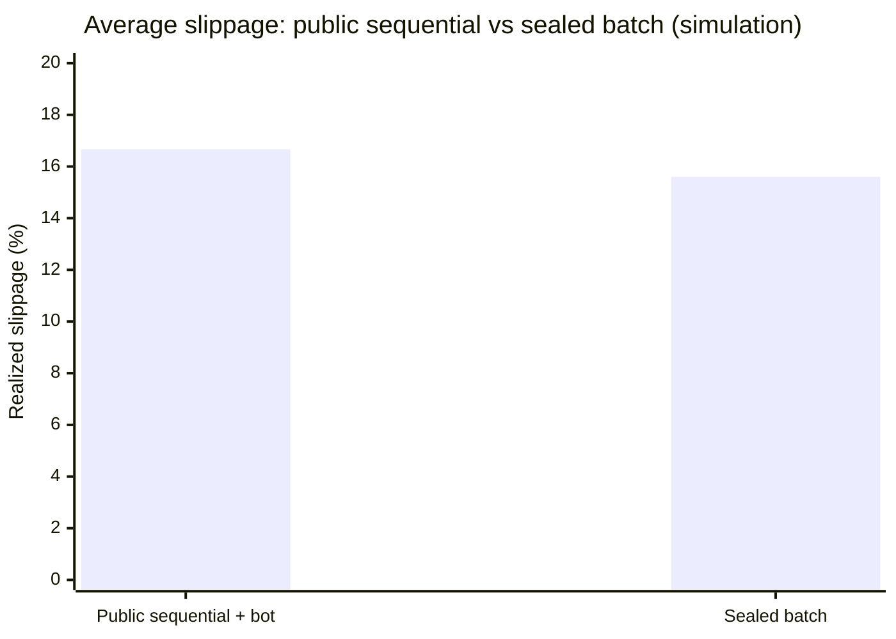

# Midge: Private Rooms with Public Rules, on NEAR

### Whitepaper: constrained arbitration, sovereign escrow and confidential coordination of capital

Written 2026-11-08, replacing the 2026-11-04 draft. It keeps that draft's argument and structure and corrects what the repository has since shown to be wrong or unprovable. Every claim cites a claim id (`foundry/claims.jsonl`), a gap (`foundry/gaps.jsonl`), a promoted lab run (`docs/lab-runs/`) or a file. `tests/whitepaper-true.test.js` fails if a cited id, run or path does not exist, if the live contract hash named here is not the last one recorded in `docs/canonical/deployments.json`, or if a statement the repository has contradicted comes back. That test cannot prove a sentence true; it stops the document drifting silently. Where a passage describes a design that is not built, it says **Design**.

**Reference deployment:** NEAR testnet contract [`c.fly-1793636729.testnet`](https://testnet.nearblocks.io/address/c.fly-1793636729.testnet).
**Live code hash:** `AFtZmiNSGMZjHsh12s9PT3hbyGRkAdUwtniXdVNnYJaL` (deployed 2026-11-08). Earlier code hashes, each with the defect it carried, are listed in `docs/canonical/deployments.json`; evidence recorded under an earlier hash cites that hash.
**Scope:** a hackathon entry on testnet. Nothing here has run on mainnet.

---

## Abstract

Coordinating money on a public blockchain has meant choosing between two bad options. On a transparent ledger, a group that acts together (a swarm of AI agents, an investment syndicate, a treasury, a DAO) shows its intentions, its sizes and its internal splits to everyone, including bots that trade against it. The usual fix, moving the deliberation off-chain, creates a different risk: whoever runs the off-chain part decides where the money goes, and if they crash, go rogue or are switched off, the funds are stuck.

Midge separates the two powers. **The money stays on NEAR**, in a public contract escrow whose rules every depositor agrees to when depositing. **The deliberation happens in a "room"**, a program (the Roost) that members seal their inputs to, that adds them up or runs a fixed rule, and that signs one proposed settlement. The room is an **arbiter and never a custodian**: it holds no withdrawal key, and the contract carries out a settlement only if it obeys the public rules (allowed recipients, a release cap, a deadline, a one-use nonce). If the room stalls or disappears, any member can take their own escrow back from the chain without anyone's permission. The design name for this is **constrained arbitration with independent recovery**.

*Plain words:* a meeting behind closed doors where nobody sees what was said, but the budget limits are posted on the wall, nobody in the room holds the cash, and every attendee has a key to get their own money back.

The same substrate carries sealed auctions, pooled deposits, quotes and requests for quote, block trades, secret ballots, payroll with private payees, and agent budgets (section 3). It is described as built where it is built, and as **Design** where it is not.

---

## 1. Introduction: the coordination trilemma

Public blockchains are very good at deterministic custody and final settlement. Their defining property, that everything is visible, works against groups that need to decide together.

```
                      The collective coordination trilemma

                               [ PRIVACY ]
                          (deliberation is not
                           visible to others)
                                  /\
                                 /  \
                                /    \
                               /  ★   \   <-- MIDGE
                              / rooms  \      (constrained arbitration,
                             /          \      independent recovery)
                            /____________\
            [ NON-CUSTODY ]                [ LIVENESS FOR MEMBERS ]
          (no operator holds the           (a member can always leave
           keys to the money)               with their own money)
```

### 1.1 The cost of being visible

When a group pools money and acts together on a transparent chain, three things leak:

1. **Intent, before it is acted on.** Published analyses of sandwich attacks on Ethereum and Solana put losses from front-running at large sums every year. This repository has not re-checked those figures, so they are not repeated here. The mechanism is not in doubt: a bot that sees a large pending order trades ahead of it and behind it.
2. **Strategy.** A public multisig or DAO vote broadcasts the proposal and the weights before they execute; competitors can copy or trade against them.
3. **People.** A treasury cannot pay staff without tying each name to a salary, and co-investors cannot seed a deal without publishing who put in how much.

### 1.2 How existing designs fail

- **A custodian bot.** A wallet key is handed to an agent or server. If the host is terminated, the keys are lost or misused, and the money goes with them.
- **An unconstrained enclave.** A secure enclave (a hardware-isolated computer) signs payouts and the contract accepts any payout it signs. If the code or the hardware is flawed, or the operator's key is stolen, the attacker signs a payout of everything. Published attacks on Intel's TDX confidential-computing hardware exist; no design should assume the hardware is perfect.
- **Recovery that needs the operator.** An exit path that depends on the same operator being up, or on a key the enclave derives, is not an independent exit.

### 1.3 Midge's answer

Midge pulls **coordination** apart from **custody**:

- *Where the money lives:* in an auditable escrow in a NEAR smart contract (`FlyCoordinator`, `contracts/fly-coordinator/src/lib.rs`).
- *Where the thinking happens:* in the room, in private.
- *Why the thinker cannot steal:* the room has no withdrawal key. It can only propose settlements that stay inside a public **release policy** the depositors accepted: allowed recipients, a cap per release window, a deadline. How strict the pacing is depends on the group's exit timer, which has to be chosen on purpose (GAP-024, GAP-025).
- *Why a failed room does not trap money:* once the group's exit timer has run, any member calls `hatch_out` on the chain and takes their own balance.

---

## 2. Core architecture

Midge is a protocol, not a single bot. One deployed contract hosts many independent groups, each with its own members, rules and room.

```
┌───────────────────────────────────────────────────────────────────────────────┐
│                       NEAR TESTNET: FLY COORDINATOR                            │
│                          c.fly-1793636729.testnet                              │
│  • escrow per member and per group        • the release policy, hashed         │
│  • verifies the room's Ed25519 signature  • one-use nonce per settlement       │
│  • per-member charges                     • hatch_out: members leave           │
│  • recovery of a stuck payout             • NEP-297 events                     │
└─────────────▲──────────────────────▲───────────────────────────▲──────────────┘
              │ (1) deposit,         │ (3) one signed             │ (4) leave
              │     naming the       │     settlement             │     alone
              │     policy hash      │     per round              │
┌─────────────┴────────┐   ┌─────────┴───────────────┐   ┌───────┴──────────────┐
│       MEMBERS        │   │   THE ROOM  (Roost)     │   │   EXIT TIMER         │
│ humans, AI agents,   │──▶│ sealed inputs in;       │   │ no room signature    │
│ sub-accounts         │   │ a fixed program; a      │   │ needed; others'      │
│                      │   │ proposed settlement out │   │ balances untouched   │
└──────────────────────┘   └─────────┬───────────────┘   └──────────────────────┘
                                     │ (2) reads, never writes, each member's escrow
                                     ▼       from two RPC providers at one block
                              NEAR RPC providers
```

### 2.1 The escrow contract

The contract is Rust on `near-sdk` 5.1. A **group** (the code calls it a syndicate) is a pool of members' money held under a public rule set. Its balances are one entry per member and group:

$$\text{escrows} : (\text{group}, \text{member}) \mapsto \text{NearToken}, \qquad \text{total\_escrow} = \sum_i \text{escrow}(f_i)$$

While no settlement is in flight, the total equals the sum of the member balances (C-01 in `foundry/invariants.json`), and deductions are exact to one yoctoNEAR (10⁻²⁴ NEAR).

#### The release policy

A creator calls `hatch` with the room's public key, a quorum, an exit timer and a release policy:

```rust
pub struct ReleasePolicy {
    pub allowed_recipients: Vec<AccountId>,   // at most 8
    pub max_release_bps_per_epoch: u16,       // share of the escrow that may leave per window; 10,000 = 100%
    pub settle_deadline_block: u64,           // no settlement after this block
}
```

- **Allowed recipients.** A settlement may pay only accounts on the list. Anything else aborts on-chain (C-03).
- **The release cap.** The most that may leave in one release window, as a share of what the group held when the window opened. A window is twice the exit timer. The cap bounds each window, not the total: measured on testnet with a 24-block timer (a window of 27 seconds), a stand-in for a compromised room was refused a second payout straight after the first and could still release about 90% in nine windows, roughly four minutes. With a one-hour timer the same release takes about 18 hours, and members wait up to an hour to exit. *Plain words:* the cap slows a thief down, and how much it slows them is the exit timer you chose. The contract accepts any timer of 10 blocks or more (GAP-024, fixed; GAP-025).
- **The deadline.** After it, no settlement is accepted, and members may exit.

Depositors consent to the policy by naming its SHA-256 hash in `deposit`. From policy version 2 the hash covers the exit timer as well as the recipients, the cap and the deadline, so a creator cannot change any of them under a depositor (C-09, GAP-025):

$$\text{policy\_hash} = \text{SHA256}(\text{canonical\_json}(\text{ReleasePolicy}, \text{exit timer}))$$

Other bounds: at most 50 members per group, a minimum deposit of 0.01 NEAR, at most 8 recipients per settlement, and a creator deposit of at least 0.005 NEAR to hatch. The member limit is C-10.

#### Settlements

The room authorises a settlement by signing, with Ed25519, one message:

$$M = \text{contract} \;:\; \text{group} \;:\; \text{epoch} \;:\; \text{round\_nonce} \;:\; \text{allocations\_hash} \;:\; \text{order\_hash}$$

- the contract id stops a signature working on another contract; the group id, on another group;
- the epoch and the round nonce stop a stale batch being replayed. The nonce changes after every settlement, so a signature works once (C-05);
- `allocations_hash` is the digest of the sorted recipient list with amounts, and `order_hash` the digest of the aggregate order. The order hash may not contain `:` (GAP-026), so two different messages can never be written the same way;
- a **charged** settlement also lists what each member pays. Each charge must not exceed that member's escrow, and the charges must sum exactly to the payout (C-11);
- a **two-room** group needs two different rooms to sign the same message.

The contract checks the signature, the recipients, the cap, the deadline, the nonce and the quorum; pays; and a callback finishes the books. If the payout transfer fails, the callback restores the money and the group's state. The first recorded settlement on an earlier code version burned 5.81 TGas, and a `hatch_out` 4.92 TGas (`docs/canonical/EVIDENCE_LEDGER.md`); later changes were not re-measured.

#### The sovereign exit

Once `min(epoch_start_block + exit timer, settle_deadline_block)` has passed and nothing is in flight, any member can call `hatch_out(group)` directly on NEAR (C-07):

1. It needs no room signature and no operator's cooperation.
2. The contract sends the caller's own remaining escrow back, clears their entry, lowers the group's total and release-cap base together (C-08), and leaves everyone else's balance untouched.
3. If the transfer fails, a callback restores the entry.
4. If a settlement is stuck in flight, anyone can finish its books after 100 blocks, so a stuck payout cannot hold the exit shut.

The full function-by-function tables, with every guard and the test that covers it, are in `docs/STATE_MACHINE.md`; `make check` fails if the document and the source drift apart. The twelve contract invariants are in `foundry/invariants.json`; the survey of states that were never named is in `docs/IMPLICIT_STATE_MACHINES.md`.

**What was checked.** 129 Rust tests (unit, integration, invariant, state-machine) pass under `E-RUST-CONTRACT`. `scripts/verify-onchain.js` checks that the chain's code hash matches the record. A source-only security audit of the contract and the room produced fifteen leads, tracked as GAP-026 to GAP-043. The contract fixes were deployed on 2026-11-08; GAP-026 and GAP-030 were re-checked live and the rest are covered by unit tests.

### 2.2 The room (the Roost) in three forms

The same rules run three ways. Each is labelled for what it does and does not protect.

**1. Local simulation** (`src/enclave/roost.js`). Exact sums, but the process can read every bid, and it says so at startup. It exists for tests and keyless demos and makes no secrecy claim. After a run it empties its queue; JavaScript gives no guarantee of overwriting memory, so no memory-erasure claim is made for it. Earlier drafts made one; it has been withdrawn.

**2. Model-sealed Roost** (`src/enclave/model-sealed-roost.js`, `src/enclave/e2ee.js`, `src/enclave/attestation.js`; CLM-ROOST-MODEL-01). Each member seals a bid to the signing key of a NEAR AI Cloud model running in Intel TDX, using an ephemeral X25519 key agreement and XChaCha20-Poly1305. Before sealing, the member checks the host's attestation themselves:

1. The attestation is an Intel TDX version 4 quote (about 5 KB). Its report data holds the model's 32-byte signing key followed by the member's fresh 32-byte nonce, so the quote cannot be replayed from another session.
2. The quote's certificate chain is verified to Intel's root with `dcap-qvl`, and the TCB status must be acceptable. A machine without `dcap-qvl` fails closed (GAP-035).
3. A caller may also pin the host's **measurements**: MRTD, RTMR0 to RTMR3 and MRSEAM, the hashes of what booted. Without a pin the quote proves only that some genuine TDX machine holds the key; with one, only a build the owner trusts is accepted (GAP-043, tests-first and mutation-checked). Nothing is pinned by default, because deciding which build to trust is the owner's decision.

If any byte of the quote is changed, verification fails.

**3. Hosted Roost** (`src/roost-service/`, `deploy/roost/`; CLM-ROOST-HOSTED-01, CLM-ROOST-HOSTED-02, CLM-ROOST-HOSTED-03). The same deterministic code in a container image pinned by digest, run inside a Phala dstack TDX confidential VM. The VM's keys are generated inside it and bound into its attestation. The compose file that names the image and its settings is **measured**, so a member who verifies the attestation also verifies which image runs and what it was told, including, since 2026-11-08, which two RPC providers it asks for escrow balances and which contract it reads. The official `dstack-verifier` accepted the 2 November build on all 12 checks, and the escrow-enabled build was attested on a real TDX machine in run `20261108T124630Z-b8de`. The VMs used in these runs were ephemeral and were deleted afterwards; **no hosted Roost is running now**.

### 2.3 What the room does with inputs

- A member's input is sealed to the room's key and signed for one round (`src/roost-service/hosted-roost.js`). The room accepts an input only for the round it was signed for, with a newer sequence number than before.
- A program (section 2.5) runs once on the queued inputs and clears the queue. A program that cannot finish (for example, more than eight sellers fill a block cross) restores the queue instead of losing bids.
- A round signs at most one settlement (R-01): once an aggregate is signed, no later run may replace it. If the contract rejects a signed round, the coordinator can **abandon** it, deliberately and on record, so the same nonce can run again (GAP-042).
- The room publishes a digest per queued input, never its content, so two rooms can check that they hold the same inputs without revealing them.

### 2.4 Rounds that cannot sink on one bad bid

A charged settlement fails entirely if one named member cannot pay. So before running a program the room reads, from at least two independent RPC providers, at one final block, what each bidder and each paying account holds, and leaves out anyone who cannot cover their worst case (`src/roost-service/escrow-reader.js`; CLM-ESCROW-BOUND-01, run `20261108T103619Z-433a`). Each provider vouches for the block by its hash; all replies must come from that block; a block that is too old is refused; two providers that disagree make the read fail. The block is recorded in the signed order hash, so anyone can look it up later. *Plain words:* before the room takes money from people, it checks, with two independent witnesses, that they have it, and it writes down which moment it checked.

The room also fails closed. On a real TDX VM whose two providers could never be reached, a charged round was refused with 503 in 55 ms, the sealed bid was still there afterwards, and nothing could be signed (CLM-ROOST-FAILCLOSED-01, run `20261108T131539Z-a3bd`).

**Limits, stated as plainly as the claim:**

- This makes a rejected settlement **much rarer, not impossible**. A member whose exit timer has already run can still leave between the read and the payout. The room reports `raceFree`, and every live run reported false.
- The attestation proves which providers the room asks, not that they answer honestly. Two agreeing providers narrow the trust; they do not remove it.
- Recovery after the providers come back, a slow (not absent) provider on hardware, and a two-room settlement on hardware were not tested.

The design is in `deploy/roost/ESCROW-READER.md`.

### 2.5 One room, many programs

The room runs small fixed programs. Each has its own rules, its own worst-case charge rule, and tests; the table of methods and guards is in `docs/STATE_MACHINE.md`.

| Program | What it does | Tests |
|---|---|---|
| Auction | Sealed first-price, second-price or uniform-price sale of a lot | `E-AUCTION-PROGRAMS-01` |
| Pool | Members pledge amounts toward a target and a recipient | `E-POOL-PROGRAM-01` |
| Quote | A lender or a buyer posts a sealed quote; takers fill it | `E-QUOTE-PROGRAMS-01` |
| Ballot | Secret vote with a quorum and a rule; members who cannot pay a share are left out | `E-BALLOT-PROGRAM-01` |
| Payrun | Private payees, private receipts | `E-PAYRUN-PROGRAM-01` |
| Request for quote | A taker asks makers for prices and takes the best | `E-RFQ-PROGRAM-01` |
| Block cross | Complementary sell and buy blocks cross at a reference price | `E-QUOTE-PROGRAMS-01` |

The programs are tested offline against the real host and service. Their runs against the real contract, with what each hides and what it does not, are written up as each ran: `docs/lab/PAYROLL_RESULTS.md`, `docs/lab/RFQ_RESULTS.md`, `docs/lab/QUOTE_CROSS_RESULTS.md`, `docs/lab/COMPARISON_AUCTIONS.md`, `docs/lab/COMPARISON_RESULTS.md`, `docs/lab/ONGOING_RESULTS.md`, `docs/lab/ROOMSERVICE_RESULTS.md`. Those runs used a local host, not a TEE.

### 2.6 Beyond NEAR: Chain Signatures

A NEAR contract can ask the NEAR Chain Signatures network, a threshold-signing service, to sign for addresses on other chains. From one group identity the design derives a Bitcoin Taproot address, an Ethereum address and a Solana key, so a group's collective decision can move assets on those chains without wrapping tokens or trusting a bridge (`src/multichain/chain-signatures.js`).

**Status, honestly.** The evidence ledger (`docs/canonical/EVIDENCE_LEDGER.md`) records a live threshold-signing call on testnet. `docs/canonical/CURRENT_STATE.md` lists the module as simulated. This paper did not re-run it, so treat it as **unverified** until `npm run verify:mpc` is re-run and the two documents agree.

---

## 3. What it is for

Because the contract is general and the programs are small, the same pieces serve very different groups. For each one: what the room hides, what stays public, and what is built.

### 3.1 Lending and repo between institutions (Design, partly built)

*The idea.* A borrower and a lender agree terms without publishing them to the market, and a borrower near liquidation is not hunted by bots that can see their health.

*What is built.* Sealed quotes and requests for quote run as programs and have been run on testnet with test accounts (`docs/lab/RFQ_RESULTS.md`, `docs/lab/QUOTE_CROSS_RESULTS.md`): a taker asks several makers, the room picks the best price, and the contract settles it. The facility models are in `src/facilities/rfq-adjudication.js`.

*What is Design.* A full repo facility needs collateral in one asset, principal in another, a margin check against a private price oracle, private cure notices, and an orderly private liquidation on default. The contract moves NEAR escrow; collateral in other assets, a confidential oracle and a liquidation path are not built. No institution has used it. Earlier drafts compared it to a banking network; that comparison rested on a figure this repository never checked and has been removed.

### 3.2 Private block trades (partly built)

Two funds that want to trade a large block without moving the market deposit assets and submit sealed limits. The room crosses complementary blocks at a reference price and settles in one batch. The cross program exists and is tested (`runCross`, at most eight sellers filled per settlement; if more would fill, the queue is restored). The reference price from a live asset registry is read, not signed over: the room trusts it as an input. **In the simulation, there is no front-running because there is nothing to see before the batch**; whether real counterparties would use it is untested (`src/facilities/otc-block-trade.js`).

### 3.3 Payroll with private payees and private receipts

An organisation that pays staff and contractors on-chain should not tie each name to a salary on a public explorer. What Midge offers is **private who, with private receipts**, not hidden amounts:

1. The organisation opens a room for each pay run and deposits the run's funds.
2. Each person gives a fresh one-time payout address for the run. Only the room knows which person owns which address, so a stranger sees amounts going to addresses they cannot name.
3. The room issues each payee a signed, encrypted receipt (invoice id, period, gross, deductions, net) and gives an auditor only category totals. The root of all receipts is in the settlement's signed order hash, so anyone can check that a receipt belongs to the run without seeing the others.

**Limits.** The amounts are public, because a settlement is a public NEAR transfer to each recipient. Stable, distinct salaries let an observer link the same person across pay runs by amount. One settlement pays at most 8 recipients, so a larger payroll is several settlements. A dishonest host could issue a wrong receipt; two rooms reduce that. This was built and run on testnet against a public pay run on a local host (`docs/lab/PAYROLL_RESULTS.md`, `E-PAYRUN-PROGRAM-01`).

### 3.4 Syndicates, pools and group decisions

- **Investing together.** Members deposit, decide and settle across epochs (`E-ONGOING-01`, `docs/lab/ONGOING_RESULTS.md`). Midge hides each backer's amount only if everyone deposits the same; when deposits equal bids the privacy gain over a public round is zero (`docs/lab/COMPARISON_RESULTS.md`).
- **Sealed auctions.** Bids stay hidden until the round closes; the clearing price and winners are public. A sealed auction against an open one, with its limits (one scripted instance with assumed strategies, not a revenue result), is in `docs/lab/COMPARISON_AUCTIONS.md`.
- **Secret ballots.** Individual votes are not revealed; the tally is. A member who cannot cover their share of the cost is left out and named (`E-BALLOT-PROGRAM-01`).

### 3.5 Agent budgets and machine payments

Autonomous agents need allowances. A human principal gives each agent a bounded sub-account, with a daily spending cap, and the agent pays for resources over the HTTP 402 payment flow without a human co-signing routine spend (`src/policies/outlayer.js`, `src/commerce/x402.js`; CLM-HATCH-01, CLM-API-01). These are tested; the sub-account model is a JavaScript mirror of the policy (`src/contracts/nest.js`), not a deployed contract.

---

## 4. A simulation, with its limits

To size the economic effect of sealing intent, `scripts/baseline.js` compares eight agents buying through a public constant-product pool (100,000 wNEAR and 396,000 USDC, reference price $3.96) against a sealed batch settled at a uniform price, with a greedy sandwich bot watching the public side. It runs 100 independent iterations with a fixed seed, reports 95% Student's t confidence intervals, and reproduces exactly with `npm run baseline`.

```
           Monte Carlo simulation, N = 100 runs (mean ± 95% CI)
┌───────────────────────────────┬───────────────────────┬─────────────────────────┐
│ Metric                        │ Public sequential     │ Sealed batch            │
├───────────────────────────────┼───────────────────────┼─────────────────────────┤
│ Realized slippage             │ 16.67% ± 0.37%        │ 15.60% ± 0.37%          │
│ Predatory bot's profit        │ $519.44 ± $16.00      │ $0.00 ± $0.00           │
│ Value preserved per swarm     │ baseline              │ +$481.09 ± $10.06       │
└───────────────────────────────┴───────────────────────┴─────────────────────────┘
```



**How to read it.**

1. **The bot's zero is true by construction.** The model gives the sealed batch no visible orders to attack, so the bot earns nothing. The figure shows the size of the effect if sealing works as assumed, not that it works that way in the field.
2. **About 1.07 percentage points lower slippage** comes from clearing the whole batch at one price instead of eight sequential trades against the pool.
3. **It is one pool, one bot type, no private order flow and no builders' auctions.** Real outcomes vary with block time, gas and the bot's cleverness.

---

## 5. Security architecture, threat model and invariants

Midge assumes any single off-chain part can fail or be hostile: the coordinator, the host, the enclave software, an RPC provider. The contract is built so that the failure of the off-chain part costs at most one bounded settlement and never a member's right to leave.

### 5.1 The invariants

The contract's invariants are stated in `foundry/invariants.json`, each tied to a Rust test, and `make check` fails if a named test or file does not exist. The load-bearing ones:

| Id | Statement (shortened) | Enforced by |
|---|---|---|
| C-01 | With no settlement in flight, the member balances sum to the group total | contract accounting |
| C-02 | In a release window, the total released never exceeds the cap times the window's base | release-window check |
| C-03 | A settlement pays only recipients on the allowed list | settlement guard |
| C-04 | A settlement needs a valid signature over the exact message | Ed25519 check over the 6-part message |
| C-05 | A round nonce works once | nonce rotation |
| C-06 | At most one settlement in flight per group | `is_settling` and the pending record |
| C-07 | After the timer or deadline, a member can take their own escrow out whatever the policy says | `hatch_out` |
| C-09 | The policy hash a depositor names covers recipients, cap, deadline and exit timer | deposit check |
| C-11 | Each charge is at most that member's escrow and the charges sum to the payout | charged settlement |
| C-12 | A group's status only moves forward (the one exception is a failed-transfer rollback) | status machine |
| R-01 | A Roost round signs at most one settlement | `HostedRoost` |

*Plain words:* the money can only go to places posted on the wall, at the pace posted, once per signature, and each member can always leave.

### 5.2 What a compromised room can and cannot do

The defences were exercised on testnet, against the live contract of the time. The three transactions, and the reasoning behind each, are recorded in `docs/security/threat-model.md`:

1. **A stolen room key signs a payout to a stranger.** The contract checks the recipient against the allowed list and aborts. The escrow does not move.
2. **A settlement over the cap.** The contract rejects it.
3. **A replayed signature.** The contract rejects the stale nonce.

These ran against an earlier code hash. The checks they exercise are still in the current code and its tests, but the transactions are not re-runs against the live hash.

What a compromised room *can* do, within the rules: propose a settlement to an allowed recipient up to the cap, once per window. That is the damage ceiling, and its size is set by the policy and the exit timer chosen when the group was created (section 2.1). A group that sets a long window and a small cap has a small ceiling and slow exits; one that sets a short window has fast exits and a faster ceiling.

### 5.3 The audit, and the residual risks

A source-only audit of the contract and the room produced fifteen leads. They are tracked as GAP-026 to GAP-043 with their evidence, and the reproduction of each is in the ledger. The ones that shaped the design: a colon in an order hash could make two messages identical (GAP-026); a payout whose callback never ran could hold an exit shut (recovery after 100 blocks); a charged settlement could be sunk by one unfunded bidder (GAP-041, section 2.4); a signed round the contract rejected could not be re-run (GAP-042); a model-host quote proved only that some genuine machine held the key (GAP-043).

The residual risks, listed rather than hidden:

- **The exit race** in section 2.4.
- **A creator who is also the operator.** A group's creator chooses the room key and the payout recipient. If a creator sets their own wallet as the recipient and their own key as the room key, they can sign a payout to themselves. Members must inspect both before depositing. Midge records them on-chain; it cannot judge them.
- **Hardware.** Published attacks on TDX exist, and a room running inside it inherits them. The design limits what a break can do to one bounded settlement per window, not to the whole escrow.
- **Public deposits and refunds.** The funding accounts, the amounts deposited and the timing of payouts are public on NEAR. Only the deliberation and the bids are private.
- **An unfunded group** (hatched, never deposited into) cannot be pruned and has no exit (GAP-030).
- **A callback whose payload is identical to another's** can be matched to the wrong record; this was accepted and is recorded for the next contract change.
- **Providers.** Escrow-bound rounds trust two RPC providers to agree and to be honest.

---

## 6. Developer interfaces

Autonomous agents should be able to use a room without a human clicking. The repository provides the same operations through four routes:

- **An MCP server** (`src/mcp/server.js`, `src/mcp/rooms-tools.js`) exposing 15 tools over stdio JSON-RPC 2.0: list and read groups, hatch, deposit, settle, hatch out, submit a sealed intent, create an RFQ, match a block trade, verify the hardware attestation, describe the rooms, open a round, submit an input, run a program, and abandon a round. Tools that change a room need the coordinator key when served over HTTP.
- **An SDK** (`src/sdk/client.js`, `src/sdk/rooms.js`) for JavaScript and TypeScript.
- **A localhost REST daemon** with server-sent events (`src/api/server.js`): it refuses to listen beyond loopback without a key, and refuses state-changing requests with a foreign `Origin`.
- **A hosted-room HTTP surface** (`src/roost-service/`) described in `docs/openapi/rooms.json`.

```
┌──────────────────────────────────────────────────────────┐
│          LLM AGENT  /  CLI  /  SCRIPT  /  SDK            │
└─────────────────────────────┬────────────────────────────┘
                              │ JSON-RPC 2.0 (stdio), HTTP
                              ▼
┌──────────────────────────────────────────────────────────┐
│                  MIDGE TOOL SURFACE                      │
└──────────────┬────────────────────────────┬──────────────┘
               ▼                            ▼
        [ CHAIN MODE ]                [ MODEL MODE ]
   live NEAR testnet RPC          in-process mirror of the
   and signed transactions        contract; offline and
                                  labelled "[MODEL MODE, no chain]"
```

In chain mode, reads work without credentials. Writes need `NEAR_ACCOUNT_ID` and `NEAR_PRIVATE_KEY` in the environment, or `MIDGE_ENV_FILE=<path>`; the client does not read the repository's `.env` on its own, and without write access a write is refused (HTTP 409 from the API, an error from the MCP server) instead of being answered by the model. Facilities, Chain Signatures, x402 and pods are simulations in every mode, and their responses say so.

---

## 7. Where it sits among related systems

This table is the author's reading of public material, not a measurement. `docs/canonical/COMPARISON.md` says the same of its sources. Check each project's own documentation before relying on a row.

| System | Privacy of deliberation | Who can move the money | If the operator disappears |
|---|---|---|---|
| **Midge** | A room in TDX hardware; inputs sealed to its attested key | A contract with posted rules; the room only proposes | Any member exits alone after the timer |
| **Canton Network** | Sub-transaction privacy between parties | A private ledger run by its validators | Depends on the validator network |
| **Phala Shade Agents** | A TEE for the agent's state | The agent controls an external wallet, with guardrails | Framework-level; no built-in per-depositor exit |
| **OutLayer** | A TEE with ephemeral keys | Payment checks and application vaults | A recovery window set for the customer |
| **NEAR Confidential Intents** | A private shard with private balances | A permissioned validator set with a bridge | Solver recovery intents; no direct exit from a stopped shard |
| **Enzyme Finance** | None; vault holdings and trades are public | Audited vault contracts | Redemption queues, subject to manager liquidity |
| **Gnosis Safe, SputnikDAO** | None; proposals and votes are public | M-of-N multisig | A deadlocked committee freezes funds |

---

## 8. Conclusion

As AI agents move from writing text to allocating money, the infrastructure under them has to change. A group cannot work on a chain where every move is read and traded against, and it cannot work in a custodial enclave where one crashed server holds its treasury.

Midge's contribution is a division of powers that can be checked. The money sits on a public chain under rules everyone accepted. The deliberation is private and runs on hardware a member can verify before sealing a bid. The room can propose, and the contract decides. And when the room fails, a member leaves alone. What it does not do is make the room perfect: the hardware, the providers, the creator's choices and the exit timer all set how much a failure can cost, and this paper tries to say what each of those costs. The evidence for each claim is something a reader can run.

---

## What is real, and what is simulated

| Component | State | Evidence |
|---|---|---|
| Contract on NEAR testnet | Deployed, live hash above | `scripts/verify-onchain.js`, `E-RUST-CONTRACT` |
| Model-sealed Roost | Live demonstrated | CLM-ROOST-MODEL-01 |
| Hosted Roost on Phala TDX | Attested on real hardware; the VMs were ephemeral | CLM-ROOST-HOSTED-02, CLM-ROOST-HOSTED-03, CLM-ROOST-FAILCLOSED-01 |
| Escrow-bound rounds | Live on testnet: local host and a TDX VM | CLM-ESCROW-BOUND-01 |
| Hardware attestation of the NEAR AI host | Live query, Intel chain checked | CLM-HAQ-01 |
| 1Click asset audit | Live read of 210 assets | CLM-INTENTS-01 |
| FAR private shard, Dark Vault pods | Simulated | CLM-VAULT-01 |
| OutLayer-style sub-accounts | Tested as a JavaScript mirror | CLM-HATCH-01 |
| Chain Signatures | Unverified; the two records disagree | `docs/canonical/EVIDENCE_LEDGER.md` |
| Lending RFQ and block trades | Programs tested; test accounts only | CLM-RFQ-01, CLM-OTC-01 |
| MCP server, SDK, REST | Integrated | CLM-MCP-01 (an older tool count), `src/mcp/server.js` |
| Simulation in section 4 | Reproduces exactly | `scripts/baseline.js` |

What runs without keys: `make verify`. Live checks need a NEAR key, a Phala key or a model key and are opt-in.

## What this does not claim

- It does not claim secrecy from the hardware vendor, from attacks on the hardware, or from a room that is the local simulation.
- It does not claim payout amounts are private. They are public.
- It does not claim a settlement can never be rejected; only that one unfunded bidder can no longer sink a round, and that the remaining case is **much rarer, not impossible**.
- It does not claim a hosted Roost is running now, or that anything has run on mainnet.
- It does not claim institutional use. The lending and block-trade programs have run against test accounts.
- It does not claim the simulation's saving holds outside the model.
- It does not claim the Chain Signatures path is verified until its two records agree.
- The documents this one replaces (SRS, RTM, architecture, use cases, research) are not published; they had drifted from the code.

---

## Reproduce

```bash
make verify          # Rust, WASM, the architectural suite and the Foundry check; about 100 s, no keys
make check           # the control plane: claims, gaps, invariants, the state-machine document
node --test tests/whitepaper-true.test.js   # that this document still cites only what exists
npm run baseline     # the simulation in section 4
node lab/verify-run.js docs/lab-runs/20261108T131539Z-a3bd   # a promoted run's hash-chained log
```
