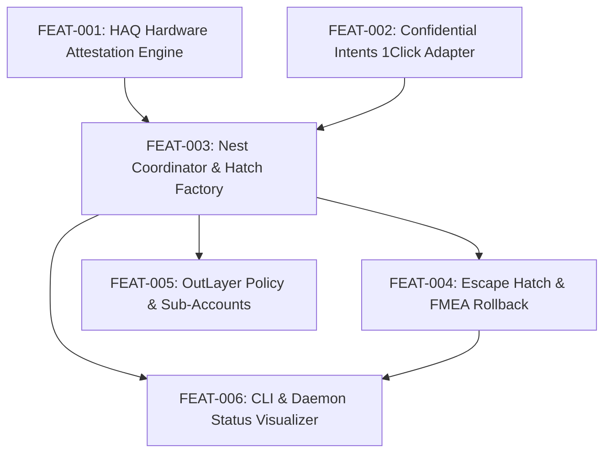

# Implementation Plan
## Project: Fly — Syndicate Network for Private Systems on NEAR
**Document Identifier:** PLAN-FLY-2026-V1.0  
**Methodology:** Agentic SDLC & Test-Driven Development (TDD)  

---

## 1. Feature Breakdown & Dependency Graph

---

## 2. Feature Slices

### FEAT-001: HAQ Hardware Attestation Engine
* **Goal:** Generate cryptographically secure 32-byte nonces and verify live Intel TDX quotes and NVIDIA GPU payloads from NEAR AI Cloud.
* **Deliverable:** `verifications/01-hardware-attestation.js`
* **Done When:** Script verifies `gateway_attestation` and `model_attestations` in <1000ms.
* **Verification:** `npm run verify:tee` $\to$ **PASS (493ms)**.

### FEAT-002: Confidential Intents 1Click Adapter
* **Goal:** Audit supported tokens and construct schema-compliant confidential intent payloads routing to the FAR Private Shard.
* **Deliverable:** `verifications/02-confidential-intents.js`
* **Done When:** Script connects to `1click.chaindefuser.com/v0/tokens`, validates >200 assets, and checks wNEAR/USDC pool prices.
* **Verification:** `npm run verify:intents` $\to$ **PASS (306ms)**.

### FEAT-003: Nest Coordinator & Hatch Factory
* **Goal:** Implement the state machine for syndicate initialization (`hatch`), sub-account registration, and attested batch settlement (`settleBatch`).
* **Deliverable:** `src/contracts/nest-coordinator.js` & `verifications/03-hatch-escape-hatch.js`
* **Done When:** Atomic function spawns `<id>.fly.testnet` and settles batch orders only when enclave code hash matches.
* **Verification:** `npm run verify:hatch` $\to$ **PASS**.

### FEAT-004: Non-Custodial Escape Hatch (`hatch_out`)
* **Goal:** Implement automated timelock failure recovery; reject premature claims, unlock 100% refund post-timeout.
* **Deliverable:** Included in Nest contract state machine.
* **Done When:** Reverts before block timeout; refunds full escrow balance after timeout.
* **Verification:** Simulated in `verifications/03-hatch-escape-hatch.js` $\to$ **PASS**.

### FEAT-005: OutLayer Policy & Sub-Account Provisioning
* **Goal:** Enforce per-flyer spending caps and recipient whitelisting at the protocol layer.
* **Deliverable:** Integrated policy guard in `MockFlyNestContract`.
* **Done When:** Over-budget deposit attempts throw an immediate policy violation error.
* **Verification:** Tested in `verifications/03-hatch-escape-hatch.js` $\to$ **PASS (Blocked 500 USDC deposit)**.

### FEAT-006: CLI & Daemon Status Visualizer
* **Goal:** Deliver an interactive visual status console displaying the active Roost, Enclave Attestation status, and live syndicate rounds.
* **Deliverable:** Live daemon status output and standalone runner.
* **Done When:** Live view renders hardware attestation status and active syndicate rounds.
* **Verification:** `./scripts/verify` or `npm run demo:syndicate`.
