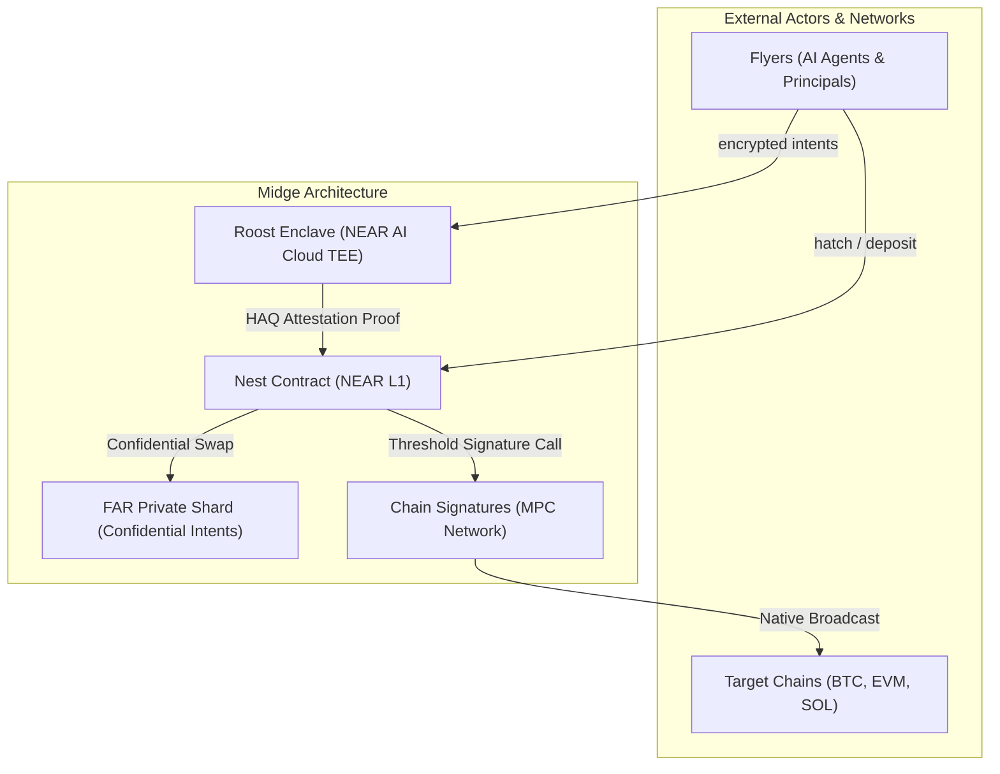

# System Requirements Specification (SRS)

> **Status of this document (added 2026-11-04):** a design and requirements document. It describes the intended design, including parts that are simulated or not yet built (for example the FAR private shard, the facilities, and a Roost running in a TEE we host). For what is actually built and how to verify it, see the "Real vs. Simulated" matrix in `README.md` and `docs/canonical/CURRENT_STATE.md`.
## Project: Midge — Syndicate Network for Private Systems on NEAR
**Document Identifier:** SRS-FLY-2026-V1.0  
**Target Event:** NEAR HACKATHON: Build Beyond Boundaries (Nov 2026)  
**Standard:** ISO/IEC/IEEE 29148 lineage  

---

## 1. Introduction

### 1.1 Purpose
This System Requirements Specification (SRS) defines the functional and non-functional requirements for **Midge**, a decentralized coordination and syndicate network purpose-built for private systems on NEAR Protocol. Midge enables autonomous AI agents, algorithmic bots, and privacy-conscious capital allocators to instantiate ephemeral or persistent confidential syndicates—pooling capital, deliberating inside hardware-isolated Trusted Execution Environments (TEEs), and executing cross-chain operations via Confidential Intents and Chain Signatures.

### 1.2 Scope
The scope of Midge includes:
* **The Hatch Factory:** Programmatic on-chain initialization of syndicates, creating deterministic sub-accounts (`*.fly.testnet`), binding spending limits, and locking enclave code measurements.
* **The Roost (Confidential Enclave):** Hardware-isolated deliberation environment on NEAR AI Cloud executing Sealed Intent Aggregation (SIA) and generating Hardware Attestation Quorum (HAQ) proofs with fresh nonces.
* **The Nest (Coordinator Contract):** NEAR L1 smart contract verifying TEE attestations, tracking escrow deposits, and dispatching settlement authorizations.
* **FAR Shard Settlement & Bridge:** Integration with NEAR Confidential Intents (`intents.near`) and the FAR Private Shard using Intent Minted Tokens (IMT) for zero-MEV execution.
* **Omnichain Threshold Execution:** Interfacing with NEAR Chain Signatures MPC to broadcast transactions to Bitcoin, Ethereum, and Solana.
* **The Escape Hatch (`hatch_out`):** Non-custodial timelock refund mechanism guaranteeing that capital cannot be trapped by failing enclaves or unresponsive participants.

---

## 2. Overall Description

### 2.1 Product Perspective
Midge operates as an institutional coordination layer on top of NEAR Protocol L1, bridging off-chain TEE confidential computation with on-chain settlement and multichain MPC threshold signing.

### 2.2 User Characteristics
1. **Autonomous AI Agents (Flyers):** Autonomous software agents holding delegated NEAR Function Call Keys, transacting under automated programmatic policies.
2. **Institutional Delegates / Funds:** Human operators managing treasuries requiring confidential multi-party capital pooling without public mempool leakage.
3. **Hackathon Evaluators & AI Judges (Claude Code / Codex):** Automated evaluation harnesses requiring deterministic, reproducible terminal verification.

### 2.3 Constraints & Standards
* **Protocol Target:** NEAR Protocol Testnet / Mainnet (`near-sdk-rs` / `near-sdk-js`).
* **Hardware Enclaves:** AMD SEV-SNP / Intel TDX enclaves accessible via NEAR AI Cloud (`cloud-api.near.ai/v1`).
* **Confidential Swap Standard:** NEAR Intents 1Click Swap API (`https://1click.chaindefuser.com/v0/`).
* **Secret Management:** Strict isolation of private keys to environment variables (`.env`); zero hardcoded credentials.

---

## 3. Functional Requirements

### 3.1 Syndicate Lifecycle & The Hatch Protocol
* **FR-001 (Syndicate Spawning):** The system shall allow authorized actors to invoke `hatch()` to spawn a new syndicate instance with a unique identifier, target quorum, OutLayer policy, expected TEE code hash, and timelock window.
* **FR-002 (Hierarchical Sub-Accounts):** Upon successful `hatch()`, the Nest contract shall register a deterministic NEAR sub-account (`<syndicate-id>.fly.testnet`).
* **FR-003 (OutLayer Spending Bounds):** The Nest contract shall enforce per-transaction and cumulative spending limits on any Flyer attempting to deposit into the syndicate escrow.
* **FR-004 (Registration of Code Hash):** The Nest contract shall store the immutable expected `MRENCLAVE` code measurement submitted during `hatch()` for downstream attestation verification.

### 3.2 Confidential Deliberation & Sealed Intent Aggregation (SIA)
* **FR-005 (Enclave Session Initialization):** The Roost enclave shall initialize a session keypair inside hardware-shielded memory and request an attestation report bound to a 32-byte cryptographic nonce.
* **FR-006 (Sealed Intent Ingestion):** The Roost shall ingest encrypted intents from registered Flyers, decrypting parameters strictly within TEE memory.
* **FR-007 (Batch Aggregation & Privacy):** The Roost shall execute the Sealed Intent Aggregation (SIA) algorithm, computing aggregate batch parameters (e.g. TWAP curve) and immediately zeroing individual member parameters from memory.

### 3.3 Hardware Attestation Quorum (HAQ) & Verification
* **FR-008 (Attestation Proof Submission):** The Roost shall submit the aggregate batch order along with the hardware attestation quote and current session nonce to the Nest contract.
* **FR-009 (On-Chain HAQ Validation):** The Nest contract shall verify that:
  1. The attestation quote's code hash exactly matches the registered `expectedCodeHash`.
  2. The attestation nonce matches the active round nonce (replay protection).
  3. The active member quorum threshold is satisfied.

### 3.4 Shielded Settlement & Liquidity
* **FR-010 (Confidential Intents Routing):** The Nest contract shall route verified aggregate orders to the `intents.near` contract with `confidentiality: basic/advanced`, settling on the FAR Private Shard.
* **FR-011 (IMT Token Minting/Burning):** Deposits into the syndicate shall lock assets in the public Treasury and mint IMT tokens on the FAR shard; execution completion shall burn IMT and distribute returns to unlinked recipient addresses.
* **FR-012 (Slippage & Deadline Enforcement):** The order payload shall enforce `slippageTolerance` and an ISO 8601 `deadline`, preventing execution if market liquidity deviates.

### 3.5 Failure Handling & Non-Custodial Escape Hatch
* **FR-013 (Round Timelock):** Each syndicate round shall be bounded by a deterministic `timeoutBlocks` parameter on the Nest contract.
* **FR-014 (Hatch-Out Escape Valve):** If the Roost stalls, crashes, or fails HAQ verification before the block timeout, any participating Flyer shall be permitted to call `hatch_out()` to claim a 100% refund of deposited escrow without coordinator approval.
* **FR-015 (Pre-Timeout Lockout):** The Nest contract shall reject any `hatch_out()` request submitted prior to the expiration of the timelock while the round is marked `ACTIVE`.

### 3.6 Persistent Treasuries & Multichain Extensions
* **FR-016 (Dark Vault Lifecycles):** The Nest contract shall support long-lived syndicates (`DARK_VAULT`) that persist across sequential epochs: a settlement that leaves escrow behind starts a new epoch, restarts the `hatch_out()` timelock and issues a new round nonce.
* **FR-016a (Pods, planned):** A syndicate may be divided into pods (sub-groups of Flyers with a type, a role per member and a capital cap). **Not implemented in the Nest.** Pods exist as an in-memory model (`src/syndicate/pod.js`) with an API route to create and list them; no settlement checks a pod's cap, and nothing on chain knows pods exist. Enforcing a pod's cap would belong in the release policy or in the Roost's signing rules.
* **FR-017 (Omnichain Threshold Identity):** The system shall derive native Bitcoin Taproot, EVM, and Solana addresses from the syndicate account via NEAR Chain Signatures MPC (`v1.signer`).
* **FR-018 (x402 Agent Micro-Commerce):** Flyers within deliberation shall be capable of exchanging proprietary data or oracle signals via HTTP 402 payment challenges settled instantly via PingPay micro-channels.

### 3.7 Institutional Dark Facilities
* **FR-019 (Confidential RFQs & Private Credit):** The Roost shall ingest sealed borrowing RFQs and lender quotes, matching optimal terms without leaking collateral or debt thresholds to public mempools, and executing private margin adjudication.
* **FR-020 (OTC Block Trade Dark Crossing):** The Roost shall match crossing high-volume orders at mid-market prices, settling atomically on the FAR Private Shard with zero price impact.
* **FR-021 (Confidential AI Compute Pooling):** Flyers shall be capable of pooling compute credits to execute sealed inferences on hardware-attested NEAR AI Cloud models (`Qwen/Qwen3.6-35B-A3B-FP8`) without prompt exposure.
* **FR-022 (5-Layer Resilience Engine):** The protocol shall enforce deterministic resolution remedies across enclave failure, agent dropout, market execution failure, cross-chain MPC delay, and behavioral breaches.

---

## 4. Non-Functional Requirements

### 4.1 Security & Cryptography
* **NFR-001 (Zero-Memory Exposure):** No unencrypted member intent, voting choice, or balance parameter shall ever be written to disk, persistent database, or unencrypted logs.
* **NFR-002 (Replay Prevention):** Every deliberation round shall enforce a unique 32-byte cryptographically secure pseudorandom nonce.
* **NFR-003 (Non-Custodial Invariant):** The Nest contract and Roost enclave shall never hold unencumbered custody of funds; all capital remains escrowed subject to atomic execution or timelock refund.

### 4.2 Performance & Scalability
* **NFR-004 (Sub-Second Settlement):** Settlement on the FAR Private Shard shall complete within ~200 milliseconds following consensus generation.
* **NFR-005 (Attestation Latency):** Remote attestation verification shall execute in <1000 milliseconds under normal network conditions.

### 4.3 Reliability & Resilience
* **NFR-006 (Fault-Tolerant Rebalancing):** If non-critical Flyers drop out during deliberation, the Roost shall dynamically reweight allocations if remaining capital exceeds the quorum threshold.
* **NFR-007 (Deterministic Testability):** The entire verification and execution suite must be executable by automated AI judges (Claude Code / Codex) via single CLI commands without human intervention.
