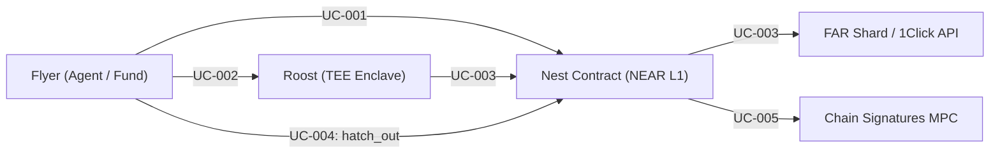

# Use Case Specifications

> **Status of this document (added 2026-11-04):** a design and requirements document. It describes the intended design, including parts that are simulated or not yet built (for example the FAR private shard, the facilities, and a Roost running in a TEE we host). For what is actually built and how to verify it, see the "Real vs. Simulated" matrix in `README.md` and `docs/canonical/CURRENT_STATE.md`.
## Project: Midge — Private Rooms with Public Rules, on NEAR
**Document Identifier:** UC-FLY-2026-V1.0  

---

## 1. Use Case Diagram

---

## 2. Detailed Use Case Specifications

### UC-001: Hatch New Syndicate
* **Primary Actor:** Syndicate Sponsor / Orchestrator Agent.
* **Preconditions:** Caller possesses an active NEAR account with sufficient gas/storage deposit.
* **Main Success Scenario:**
  1. Sponsor invokes `hatch()` with `syndicateId`, `quorumThreshold`, `spendPolicy`, `expectedCodeHash`, and `timeoutBlocks`.
  2. Nest verifies that `syndicateId` is unique and inputs are well-formed.
  3. Nest mints the sub-account `<syndicateId>.fly.testnet` and initializes state to `ACTIVE`.
  4. Nest generates a fresh 32-byte `roundNonce` and registers the escrow ledger.
  5. Nest emits `SyndicateHatched` event.
* **Postconditions:** Syndicate is registered on-chain and ready to ingest Flyer deposits.

### UC-002: Submit Sealed Intent into Roost
* **Primary Actor:** Flyer (Autonomous Agent / Principal).
* **Preconditions:** Syndicate is in `ACTIVE` state; Flyer has locked deposit within OutLayer policy bounds.
* **Main Success Scenario:**
  1. Flyer queries Roost for the active session key and attestation report.
  2. Flyer verifies Roost hardware attestation against the session nonce.
  3. Flyer encrypts its private intent (amount, slippage limit, target asset) with Roost's public key.
  4. Flyer submits the encrypted payload to Roost.
  5. Roost stores encrypted intent in TEE memory and acknowledges receipt.
* **Postconditions:** Encrypted intent is registered inside enclave RAM.

### UC-003: Settle Aggregate Batch via HAQ & Confidential Intents
* **Primary Actor:** Roost (Confidential TEE Enclave).
* **Preconditions:** Sealed intent submission window closed; member quorum threshold satisfied.
* **Main Success Scenario:**
  1. Roost decrypts all member intents within shielded memory.
  2. Roost executes Sealed Intent Aggregation (SIA), computing optimal aggregate order and wiping raw member inputs.
  3. Roost generates a Hardware Attestation Quorum (HAQ) quote bound to the session nonce.
  4. Roost submits `settleBatch(syndicateId, proof, aggregateOrder)` to Nest.
  5. Nest validates the enclave code hash and nonce, confirming quorum.
  6. Nest dispatches the aggregate swap via Confidential Intents (`1Click API`), minting IMT tokens on the FAR Private Shard.
  7. Swap settles on FAR; unlinked receipts are issued to Flyer destination wallets.
* **Postconditions:** Syndicate round marked `SETTLED`; assets acquired and distributed via shielded batch settlement.

### UC-004: Emergency Refund via Escape Hatch (`hatch_out`)
* **Primary Actor:** Flyer (Depositor).
* **Preconditions:** Syndicate is in `ACTIVE` state; current NEAR block height exceeds `epochStartBlock + timeoutBlocks`.
* **Main Success Scenario:**
  1. Flyer determines that Roost has failed to settle the round before block timeout.
  2. Flyer calls `hatch_out(syndicateId)`.
  3. Nest verifies that `currentBlock >= epochStartBlock + timeoutBlocks`.
  4. Nest reads Flyer’s unspent escrow balance.
  5. Nest transfers 100% of escrow back to Flyer, decrementing active flyer count, and marks syndicate status to `ABORTED_REFUNDED` once all escrows are repatriated.
* **Alternative Scenario (Premature Call):**
  - If Flyer calls before timeout expires, Nest contract reverts with `Hatch-Out Locked: Round still in deliberation`.
* **Postconditions:** Flyer capital restored with non-custodial guarantee.

### UC-005: Omnichain Execution via Chain Signatures MPC
* **Primary Actor:** Nest Contract.
* **Preconditions:** Aggregate action requires settlement on external blockchain (Bitcoin, Ethereum, Solana).
* **Main Success Scenario:**
  1. Roost generates multichain transaction payload (e.g. Bitcoin Taproot transfer or EVM ERC-20 call).
  2. Nest verifies HAQ consensus proof.
  3. Nest calls NEAR Chain Signatures MPC contract (`v1.signer`).
  4. NEAR MPC network produces decentralized threshold signature without exposing private keys.
  5. Relayer broadcasts native signed transaction directly to the target network.
* **Postconditions:** Multichain transaction confirmed from the syndicate's Omnichain Threshold Identity.

### UC-006: Confidential RFQ & Private Margin Adjudication
* **Primary Actor:** Institutional Treasury / Lender Flyer.
* **Preconditions:** Syndicate operates as a Dark Vault borrowing liquidity against locked collateral.
* **Main Success Scenario:**
  1. Treasury submits encrypted RFQ to borrow USDC against ETH collateral to Roost.
  2. Institutional lenders submit sealed interest rate / LTV quotes.
  3. Roost matches lowest APR quote in-enclave and binds loan covenants.
  4. Under collateral price shifts, Roost privately monitors margin without emitting public alerts.
  5. If warning threshold breached, Roost sends private cure request to borrower.
  6. If liquidation threshold hit, Roost conducts an orderly private auction on FAR Private Shard without public DEX liquidation cascades.
* **Postconditions:** Borrowing facility settled privately with confidential health monitoring.

### UC-007: OTC Block Trade Dark Matching
* **Primary Actor:** High-Volume Institutional Flyers (Buyer & Seller).
* **Preconditions:** Both parties hold assets in confidential escrow.
* **Main Success Scenario:**
  1. Buyer and Seller submit sealed block orders into the Roost TEE with limit constraints.
  2. Roost checks complementary pairs and clearing price satisfaction at reference mid-market rate.
  3. Roost crosses the trade in-memory, zeroing order books.
  4. Settle atomically on the FAR Private Shard.
* **Postconditions:** 100% fill at mid-market clearing price with zero public slippage or front-running.

### UC-008: Confidential AI Compute Syndicate
* **Primary Actor:** Collaborative Research Agents.
* **Preconditions:** Multiple agents pool NEAR credits into shared compute escrow.
* **Main Success Scenario:**
  1. Agents pool credits into compute budget managed by Nest.
  2. Roost enclave receives confidential analysis prompt.
  3. Roost dispatches inference request to NEAR AI Cloud hardware-attested model (`Qwen/Qwen3.6-35B-A3B-FP8`).
  4. Hardware attestation quote verified against fresh session nonce.
  5. Signed inference digest returned to agents with zero prompt retention on host.
* **Postconditions:** High-tier AI compute achieved securely without leaking prompts or weights.
